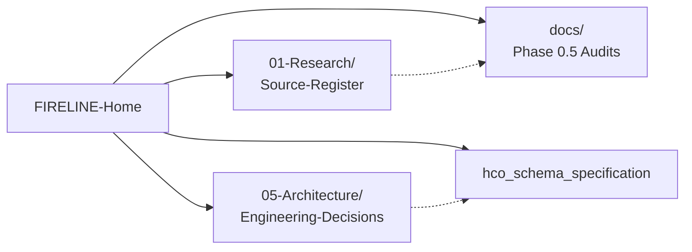

# 🔥 FIRELINE — Scientific Knowledge Base & Engineering Dashboard
**Fire Intelligence & Research Evidence Linkage Engine**  
*Lead Development & Systems Design: CIPHER (Decode. Build. Evolve.)*  
*Target: NASA Space Apps Challenge 2026 — Physical Sciences Informatics (Combustion)*

---

## 📌 Mission Objective
FIRELINE is an auditable scientific evidence engine for space-fire safety research. It answers a fundamental question:  
> *Given a spacecraft mission profile and environmental boundary conditions, what does NASA's microgravity experimental evidence verify, what can be physically inferred, and where do critical empirical gaps remain?*

---

## 🧭 Vault Navigation & Core Registers

### 1. Primary Architecture & Specifications
* 📄 [[hco_schema_specification|Harmonized Combustion Ontology (HCO) Specification]] — Original ontology and preliminary data contracts.
* 🏛️ [[05-Architecture/Engineering-Decisions|Engineering Decision Log]] — Formal architectural decisions, data boundaries, and technology rationales.

### 2. Scientific Evidence & Investigation Registers
* 🔬 [[01-Research/Source-Register|NASA PSI Source Register]] — Master index of active investigations (`FLEX`, `BASS-II`, `Saffire`, `SoFIE`), official repository URLs, dataset availability, and claim verification statuses.
* 💧 [[01-Research/FLEX-Research-Notes|FLEX Research Notes (PSI-69)]] — Droplet combustion, burning rate constants, radiative & cool-flame extinction kinetics.
* 🪵 [[01-Research/BASS-II-Research-Notes|BASS-II Research Notes (PSI-25)]] — Solid PMMA slabs/rods, low-speed flow flammability boundaries, and radiative quenching limits.
* 🚀 [[01-Research/Saffire-I-Research-Notes|Saffire-I Research Notes (PSI-98)]] — Macro-scale SIBAL fabric burns, concurrent spread dynamics, and spacecraft cabin pressurization.
* 🔄 [[01-Research/Cross-Investigation-Analysis|Cross-Investigation Analysis]] — Comparative synthesis across transport regimes, scale, fuel phases, and physical compatibility rules.
* ❓ [[01-Research/Scientific-Questions|Scientific Questions & Roadmap]] — Open physical scaling questions (partial gravity, exploration atmospheres, LOI shifts).

### 3. Phase 0 & Phase 0.5 Audit, Review & Verification Documents
* 📜 [[docs/phase00_official_challenge_review|Phase 0 Official Challenge Review]] — Authoritative requirements traceability, judging criteria mapping, and NASA rules compliance.
* 📋 [[docs/source_verification_matrix|Source Verification Matrix]] — Field-by-field verification of all empirical finding records against NASA PSI data and DOI resolutions.
* 📐 [[docs/hco_schema_change_proposal|HCO Schema Change Proposal]] — Structural updates for `ScientificValue<T>`, dual original/normalized units, and non-nullable field remediation.
* ⚖️ [[docs/evidence_classifier_review|Evidence Classifier Mathematical Review]] — Analysis of 4D Delaunay triangulation failure modes and definition of the 4-tier Gated Rule Classifier.
* 🏁 [[docs/phase05_exit_report|Phase 0.5 Exit Report]] — Summary of ground-truth findings, production gate criteria, and roadmap.

---

## 🎯 Project Milestones & Phase Status

| Milestone | Scope | Status | Blockers / Dependencies |
| :--- | :--- | :--- | :--- |
| **Phase 0** | Official Challenge Review & Traceability | ✅ **COMPLETED** | Fully audited against NASA 2026 challenge brief |
| **Phase 0.5** | Ground-Truth Verification & Classifier Audit | ✅ **COMPLETED** | Schema updates proposed and gated |
| **Preparation Phase** | Knowledge Base Setup, Schema Solidification, Ingestion Architecture | 🟡 **ACTIVE** | Respect NASA rules: No competition code before Nov 14 |
| **Phase 1** | Verified NASA PSI Data Ingestion Pipeline | ⏳ *Scheduled for Hackathon* | Standby for event kickoff (Nov 14–15, 2026) |
| **Phase 2** | Gated Deterministic Evidence Classification Engine | ⏳ *Scheduled for Hackathon* | Dependent on Phase 1 verified ingestion |
| **Phase 3** | Evidence Map, Evidence Chain & Mission Assessor UI | ⏳ *Scheduled for Hackathon* | Dependent on Phase 2 classification engine |

---

## ⚠️ Knowledge Integrity Protocol
1. **Never conflate illustrative mock data with verified NASA empirical findings.** All synthetic records must carry the `SYNTHETIC_ILLUSTRATIVE` tag and remain barred from search and ranking.
2. **Preserve original measurements.** Raw reported values and engineering units ($psia$, $in$, $ft/min$) must remain linked to normalized SI values.
3. **No black-box extrapolation.** Classifications must strictly output `SUPPORTED`, `INFERRED`, or `EVIDENCE_GAP` with explicit reason codes.
