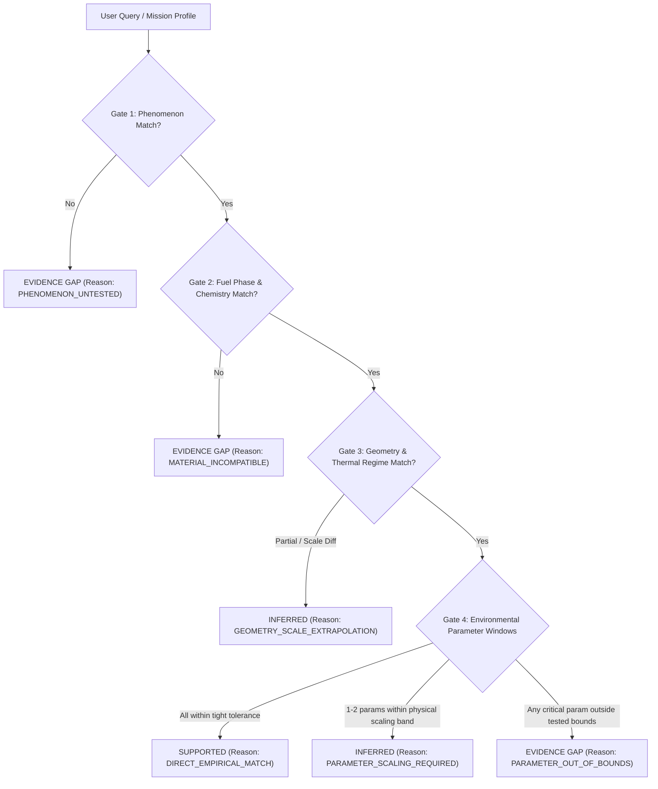

# Evidence Classifier Mathematical Review & Alternative Proposal
**Milestone**: Phase 0.5 — Algorithmic Validation  
**Target**: Evidence Classification Engine (SUPPORTED / INFERRED / EVIDENCE GAP)  
**Author**: Lead Systems Verification Engineer & Combustion Data Researcher

---

## 1. Mathematical Analysis of the Proposed Delaunay/Convex-Hull Classifier

The preliminary specification (`hco_schema_specification.md`) proposed classifying evidence using a 4D Delaunay triangulation and an exponential sample-density threshold over a normalized environmental vector:
$$\mathbf{x} = \begin{bmatrix} g & P_{\text{norm}} & X_{\mathrm{O_2,norm}} & u_{\text{norm}} \end{bmatrix}$$

An in-depth mathematical audit reveals 12 fundamental failure modes that make this approach unusable in its current form:

### 1. Sample Size Underflow ($N < D + 1$)
* **Finding**: A Delaunay triangulation in $D$-dimensional Euclidean space requires at least $D + 1$ affinely independent points to construct even a single valid simplex.
* **Failure**: For $D = 4$, a minimum of 5 points in general position is mathematically required. The 4 preliminary example records guarantee immediate algorithmic failure (`QhullError: degenerate or insufficient points`).

### 2. Subspace Collapse & Coplanarity
* **Finding**: In microgravity combustion research, flight experiments (ISS CIR, Cygnus Saffire) share $g = 0.0$.
* **Failure**: All space-based data points lie on the affine hyperplane $g = 0$. The 4D volume of the convex hull is identically zero ($\text{Vol}_{4D} = 0$). Triangulation packages (such as SciPy `Delaunay` or Qhull) fail with a rank-deficiency exception or produce flat, degenerate simplices.

### 3. Constant / Invariant Parameter Behavior
* **Finding**: Within specific investigations, environmental parameters are often fixed by hardware design (e.g., $u_\infty = 0$ in quiescent chambers, or $P = 101.3\text{ kPa}$ in glovebox experiments).
* **Failure**: Whenever any parameter has zero variance across a test series, the coordinate covariance matrix is singular.

### 4. Handling of Missing & Unmeasured Variables
* **Finding**: Real experimental runs frequently lack specific parameters (e.g., radiant flux is null, ambient temperature is unrecorded).
* **Failure**: Vector metrics like Euclidean distance $\|\mathbf{x}_1 - \mathbf{x}_2\|_2$ and simplex inclusion tests are undefined with `null` or `NaN` values. Imputing zeros alters the physical location in phase space (e.g., setting missing flow to $0\text{ cm/s}$ falsely implies a quiescent stagnation flame).

### 5. Out-of-Bounds Behavior
* **Finding**: Normalization formulas assumed fixed bounds: $g \in [0, 1]$, $P \in [40, 101.3]\text{ kPa}$, $X_{O_2} \in [0.15, 0.40]$.
* **Failure**: Queries testing hyperbaric pressures ($P > 101.3\text{ kPa}$) or rich oxygen environments ($X_{O_2} > 40\%$) produce coordinates outside $[0, 1]^4$. Convex-hull inclusion tests return false for any point outside, but cannot differentiate an extrapolation by $1\%$ from an extrapolation by $500\%$.

### 6. Cold-Start and Sparse Datasets
* **Finding**: If a newly indexed sub-investigation has only 2 or 3 test runs, Delaunay triangulation cannot initialize.
* **Failure**: The entire classification pipeline crashes during cold-start or per-material filtering.

### 7. Physical Incompatibility (Fuel & Geometry Blindness)
* **Finding**: The 4D vector considers only environmental boundary conditions ($g, P, X_{O_2}, u_\infty$).
* **Failure**: A liquid $n$-heptane droplet (FLEX) and a thick solid PMMA cylinder (SoFIE) tested at identical environmental coordinates ($0g, 101.3\text{ kPa}, 21\% O_2, 0\text{ cm/s}$) would be evaluated as identical points in parameter space. Concluding that a PMMA fire safety question is "SUPPORTED" by droplet extinction data is scientifically invalid.

### 8. Phenomenon Incommensurability
* **Finding**: Extinction quenching, concurrent flame spread rate, ignition delay, and soot volume fraction are distinct physical mechanisms governed by different timescales and transport equations.
* **Failure**: Proximity in environmental space does not transfer across phenomena. Empirical data measuring droplet extinction cannot "support" a question about solid fuel flame spread rates.

### 9. Duplicate & Correlated Run Distortion
* **Finding**: NASA test series often repeat identical nominal conditions 5 to 10 times to verify statistical repeatability.
* **Failure**: Ten repeated runs at the exact same condition falsely inflate the local density metric ($\sum \exp(-\lambda k)$), giving the impression of broad parameter coverage when only a single physical point was tested.

### 10. The Convex-Hull Interpolation Fallacy
* **Finding**: Combustion phenomena exhibit non-linear cliff behaviors (e.g., flammability limits, low-speed radiative quenching, blowoff extinction).
* **Failure**: Being located geometrically "between" two successful test runs does not imply that the intermediate condition will sustain combustion.

### 11. Unjustified Density Formula
* **Finding**: The formula $C = 1 - e^{-0.8 k}$ was a purely heuristic mathematical curve.
* **Failure**: The choice of decay factor ($0.8$) and neighbor radius ($\epsilon = 0.15$) has no empirical calibration against combustion repeatability or measurement variance.

### 12. Lack of Scientific Validation
* **Finding**: The classifier output was previously presented as an objective confidence metric.
* **Failure**: Presenting an uncalibrated geometric heuristic as "scientific confidence" violates NASA Space Apps validity criteria.

---

## 2. Proposed Alternative: Transparent Gated Rule Classifier

Instead of uncalibrated multi-dimensional geometric hulls, FIRELINE will implement an **interpretable, deterministic rule-based matching engine with explicit physical gating and auditable reason codes**.



### 2.1 The Four Gating Tiers

1. **Gate 1 — Phenomenon Gating (Strict Binary)**:
   * The candidate finding must match the target observable phenomenon (e.g., `flame_extinction_quenching` matches only extinction queries).
   * Mismatch immediately yields `EVIDENCE_GAP`.

2. **Gate 2 — Material & Fuel Phase Gating (Physical Compatibility)**:
   * `solid` fuels never match `liquid` or `gaseous` fuels.
   * Solid fuels match within chemical families (e.g., PMMA cast vs. PMMA extruded; cotton fabric vs. SIBAL blend).
   * If fuel phase matches but material differs: capped at `INFERRED` with reason code `MATERIAL_ANALOGUE`.

3. **Gate 3 — Geometry & Thermal Regime Gating**:
   * Distinguishes **thermally thin** materials ($Bi < 0.1$, e.g., thin paper/fabric where temperature is uniform across thickness) from **thermally thick** materials ($Bi > 1.0$, e.g., solid rods/slabs where surface pyrolyzes while core remains cold).
   * Cross-regime comparison capped at `INFERRED` with reason code `THERMAL_REGIME_MISMATCH`.

4. **Gate 4 — Environmental Parameter Windows**:
   * Evaluated per parameter with defined physical tolerances:
     * **Gravity**: Exact regime match ($0g$, Lunar, Martian, 1g). If user queries Martian ($0.38g$) and data is $0g$: marked `INFERRED` or `EVIDENCE_GAP` with explicit reason `GRAVITY_REGIME_DISCREPANCY`.
     * **Pressure**: Direct match within $\pm 10\%$. Scaling match within $\pm 30\%$. Outside: `EVIDENCE_GAP`.
     * **Oxygen**: Direct match within $\pm 2\%$ absolute mole fraction. Scaling match within $\pm 5\%$. Outside: `EVIDENCE_GAP`.
     * **Flow Velocity**: Direct match within $\pm 2\text{ cm/s}$. Forced flow cannot be inferred from quiescent data ($u = 0$).

### 2.2 Traceable Output Structure
Every classification returns an auditable verdict:
```typescript
export interface ClassificationVerdict {
  classification: 'SUPPORTED' | 'INFERRED' | 'EVIDENCE_GAP';
  primary_reason_code: 
    | 'DIRECT_EMPIRICAL_MATCH'
    | 'MATERIAL_ANALOGUE_INFERRED'
    | 'GEOMETRY_SCALE_EXTRAPOLATION'
    | 'PARAMETER_SCALING_REQUIRED'
    | 'GRAVITY_REGIME_DISCREPANCY'
    | 'PHENOMENON_UNTESTED'
    | 'MATERIAL_INCOMPATIBLE'
    | 'PARAMETER_OUT_OF_BOUNDS';
  explanation: string;
  matched_findings_count: number;
  matched_finding_ids: string[];
  parameter_discrepancies: {
    parameter: string;
    queried_value: any;
    tested_range: [any, any] | null;
    status: 'EXACT_MATCH' | 'SCALABLE' | 'OUT_OF_BOUNDS' | 'UNTESTED';
  }[];
}
```

---

## 3. Test Cases Required Before Implementation

Before the evidence classification engine is deployed, it must pass a suite of deterministic test cases:

| Test Case ID | Query Input | Candidate Records in DB | Expected Output | Critical Check |
| :--- | :--- | :--- | :--- | :--- |
| `TC-CLS-01` | PMMA, Opposed Spread, $0g$, $101.3\text{ kPa}$, $21\% O_2$, $2.0\text{ cm/s}$ | BASS-II Run 18 ($0g, 101.3\text{ kPa}, 20.8\% O_2, 2.2\text{ cm/s}$) | **SUPPORTED** (`DIRECT_EMPIRICAL_MATCH`) | Confirms tight tolerance match succeeds. |
| `TC-CLS-02` | PMMA, Extinction, $0g$, $101.3\text{ kPa}$, $21\% O_2$, $0\text{ cm/s}$ | FLEX Droplet Run 42 ($0g, 101.3\text{ kPa}, 21\% O_2, 0\text{ cm/s}$) | **EVIDENCE_GAP** (`MATERIAL_INCOMPATIBLE`) | Prevents droplet data from matching solid fuel questions. |
| `TC-CLS-03` | PMMA, Extinction, Mars ($0.38g$), $70\text{ kPa}$, $30\% O_2$ | BASS-II & SoFIE ($0g$, various pressures) | **INFERRED** or **EVIDENCE_GAP** (`GRAVITY_REGIME_DISCREPANCY`) | Prevents claim that microgravity data directly proves partial-gravity behavior. |
| `TC-CLS-04` | PMMA, Opposed Spread, Missing ambient temperature | BASS-II Run 18 (ambient temp is null) | **SUPPORTED** | Confirms null non-critical field does not crash classifier. |
| `TC-CLS-05` | PMMA, Soot Production | BASS-II & SoFIE records (spread & extinction only) | **EVIDENCE_GAP** (`PHENOMENON_UNTESTED`) | Confirms phenomenon mismatch triggers immediate gap. |
