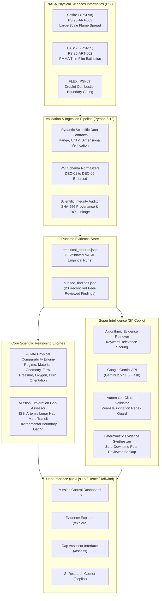
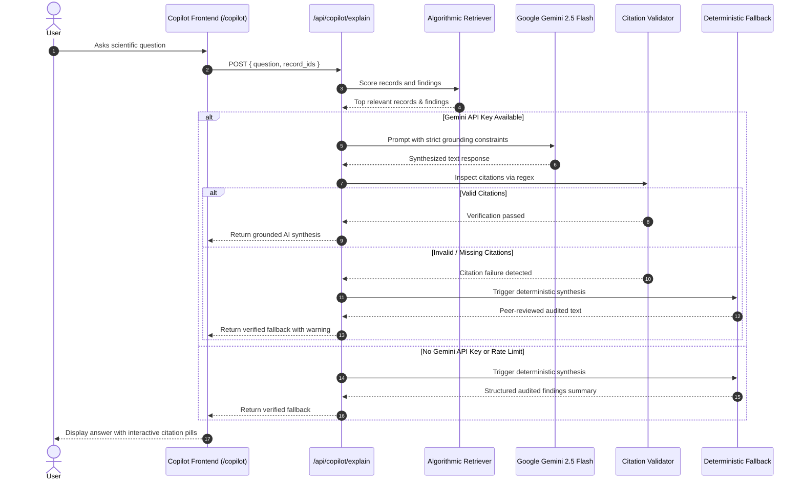

# FIRELINE System Architecture Specification

**Project:** FIRELINE — Fire Intelligence & Research Evidence Linkage Engine  
**Challenge:** NASA Space Apps Challenge 2026 — Flame in Freefall  
**Agency:** Moon Sanctum Labs (*Decode. Build. Evolve.*)  
**Lead Developer:** Aniket Nandi (Kolkata, IST)  
**Status:** Complete / Production-Ready  
**Revision:** v1.0.0 (Release Baseline)

---

## 1. High-Level Architectural Vision

FIRELINE is an evidence-first, physically grounded decision-support engine designed to assist human spaceflight engineers, flight surgeons, and safety boards in interpreting microgravity combustion phenomena. Unlike generic LLM chat applications or black-box regression algorithms, FIRELINE enforces strict physical comparability, transparent data provenance, and deterministic boundary verification before synthesizing any scientific insight.

---

## 2. Layered Architecture Breakdown

### 2.1 Ingestion & Validation Layer (Python 3.12 / Pydantic)
- **Location:** `backend/src/fireline_data/`
- **Responsibilities:**
  - Ingests raw experimental CSV data from NASA PSI repositories (`PSI98-ART-002`, `PSI25-ART-002`).
  - Validates all records through Pydantic contracts enforcing strict physical constraints:
    - Oxygen concentration: $0.0 \le \% \text{O}_2 \le 100.0$
    - Ambient pressure: $P > 0\text{ kPa}$
    - Physical dimensions: $W > 0, L > 0, T > 0$
    - Gas velocities: $v \ge 0\text{ cm/s}$
    - Burn rates: $r \ge 0\text{ mm/s}$ or `null` for unmeasured runs.
  - Enforces Engineering Decisions (`DEC-01` to `DEC-05`):
    - `DEC-01`: Null preservation over zero-imputation.
    - `DEC-02`: Droplet combustion records (FLEX) deferred from tabular record search; findings indexed for boundary gating.
    - `DEC-03`: Canonical NASA run naming (`PSI98-F1C1/F1C2`).
    - `DEC-04`: Retaining raw BASS-II fan dial readings without uncalibrated aerodynamic conversions.
    - `DEC-05`: Strict partition between empirical chamber measurements and derived/telemetry pressure surges.

### 2.2 Storage & Runtime Data Store
- **Location:** `src/data/empirical_records.json` and `src/data/audited_findings.json`
- **Design Decision:**
  - High-performance, zero-latency in-memory data store serialized directly into the Next.js production build bundle.
  - Guarantees instant sub-millisecond retrieval times without network latency or external database connection failures.
  - Fully decoupled and reproducible: every record contains its SHA-256 integrity hash and direct link to the original NASA PSI artifact.

### 2.3 7-Gate Physical Comparability Engine
- **Location:** `src/app/api/evidence/compare/route.ts` & `backend/src/fireline_data/comparability/`
- **Methodology:**
  When two microgravity experiments ($A$ and $B$) are compared, the engine executes seven deterministic physical gate checks:

| Gate | Physical Parameter | Condition for Pass | Thermodynamic Rationale |
|:---|:---|:---|:---|
| **Gate 1** | **Combustion Regime** | $R_A = R_B$ | Microgravity surface flame spread over solids cannot be compared with liquid droplet combustion or premixed gas combustion. |
| **Gate 2** | **Fuel Material Family** | $\text{Family}_A = \text{Family}_B$ | Cellulosic fabric blends (SIBAL) exhibit different pyrolysis kinetics and charring behavior than pure thermoplastics (PMMA). |
| **Gate 3** | **Sample Geometry & Biot Number** | $\text{Geom}_A = \text{Geom}_B$ and thickness compatibility | Thermally thin fuels ($\text{Bi} \ll 1$) have uniform internal temperature profiles; thermally thick fuels ($\text{Bi} \ge 1$) have substantial conduction gradients into the solid. |
| **Gate 4** | **Forced Convective Flow** | $\left\|\frac{v_A - v_B}{v_A}\right\| \le 0.25$ | In microgravity, absence of buoyancy makes forced ventilation the primary oxidizer transport mechanism; divergent velocities change flame chemistry. |
| **Gate 5** | **Ambient Pressure** | $|P_A - P_B| \le 10.0\text{ kPa}$ | Pressure governs gas-phase chemical reaction rates and radiation absorption coefficients. |
| **Gate 6** | **Oxygen Concentration** | $|\% \text{O}_{2,A} - \% \text{O}_{2,B}| \le 2.0\%$ | Oxygen concentration controls adiabatic flame temperature and extinction limits. |
| **Gate 7** | **Burn Orientation** | $\text{Orient}_A = \text{Orient}_B$ | Opposed-flow flame spread (flame propagates against airflow) exhibits radically different boundary layer heat transfer than concurrent spread (flame spreads with flow). |

**Output Classifications:**
- `FULLY_COMPARABLE`: 7/7 gates passed.
- `CONDITIONALLY_COMPARABLE`: Gate 1, 2, 3, 7 pass; minor deviations in flow or pressure (gates 4, 5, or 6 fail).
- `INCOMPARABLE`: Critical thermodynamic failure in gates 1, 2, 3, or 7.
- `CONFLICTING`: Comparable environmental parameters exhibiting divergent empirical outcomes (flags potential experimental anomaly).

### 2.4 Exploration Mission Gap Assessor Engine
- **Location:** `src/app/api/assess/route.ts` & `backend/src/fireline_data/assessment/`
- **Methodology:**
  Evaluates exploration mission architectures against the empirical microgravity envelope.
  - **Artemis Lunar Habitat ($34\%\ \text{O}_2,\ 56.5\text{ kPa}$):**
    - Identifies that NASA empirical testing in microgravity has primarily examined either normoxic ambient ($21\%\ \text{O}_2,\ 100\text{ kPa}$) or hypoxic conditions ($16\text{--}20\%\ \text{O}_2$).
    - Identifies the severe empirical gap: no large-scale microgravity tests have been executed under hypobaric, hyperoxic exploration conditions ($34\%\ \text{O}_2,\ 56.5\text{ kPa}$).
    - Outputs quantitative parameter coverage percentages, risk boundaries, and specific flight experiment recommendations.
  - **ISS Nominal ($21\%\ \text{O}_2,\ 101.3\text{ kPa}$):**
    - High empirical coverage ($>80\%$) via BASS-II and Saffire-I.
  - **Mars Surface Habitat ($28\%\ \text{O}_2,\ 70.3\text{ kPa}$):**
    - Identifies partial gravity ($0.38\text{ g}$) buoyant interaction gap.

### 2.5 Super Intelligence (SI) Research Copilot
- **Location:** `src/app/api/copilot/explain/route.ts` & `backend/src/fireline_data/copilot/`
- **Workflow:**

---

## 3. Frontend & Presentation Layer Architecture

- **Framework:** Next.js 15.5.29 (App Router, Server-Side Rendering & Static Generation)
- **Language:** TypeScript 5.7 (Strict Mode)
- **Styling:** Tailwind CSS 3.4
- **Design Tokens:** Moon Sanctum Labs Identity (Space Grotesk, Manrope, Ink `#0F1013`, Bone `#F2EFE8`, Copper `#E0A45C`, Slate `#8B9099`)
- **Key Routing Architecture:**
  - `/`: Mission Control Overview, global metrics, quick-start mission scenarios.
  - `/explore`: Evidence Explorer with instant client-side multi-parameter filtering, detail view drawer, and audit metadata inspection.
  - `/assess`: Mission Environmental Gap Assessor with dynamic preset selection via `?preset=artemis_lunar` and customizable sliders.
  - `/copilot`: SI Research Copilot with interactive conversation stream, question presets, and citation chip validation.
  - `<Suspense>` Isolation: All client components reading query parameters (`useSearchParams()`) are wrapped in React `<Suspense>` boundaries to guarantee zero-error static page generation at build time.

---

## 4. Security & Epistemic Boundaries

1. **Zero Hallucination Guarantee:** The SI Copilot is architecturally prohibited from emitting claims without grounding citations. Any failure automatically drops back to deterministic audited text.
2. **Epistemic Labeling:** All responses, assessments, and findings are strictly labeled as `SUPPORTED`, `INFERRED`, or `EVIDENCE_GAP`.
3. **No Safety Certifications:** FIRELINE explicitly displays disclaimers confirming that it is an evidence decision-support tool, not an authorized NASA safety compliance authority.

---
*Moon Sanctum Labs — Decode. Build. Evolve.*
