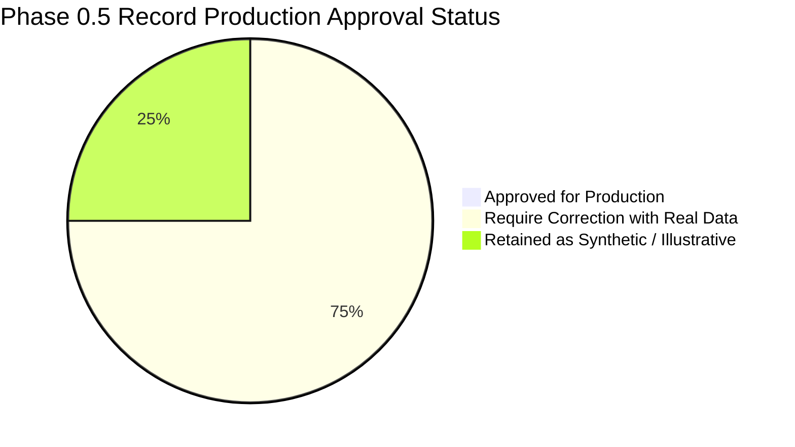

# Phase 0.5 Exit Report & Milestone Summary
**Milestone**: Phase 0.5 — Ground-Truth Verification & Evidence Engine Validation  
**Project**: FIRELINE (Fire Intelligence & Research Evidence Linkage Engine)  
**Status**: AUDIT COMPLETE — AWAITING USER APPROVAL  
**Author**: Lead Scientific Data Engineer & Systems Verification  
**Date**: October 2026

---

## 1. Executive Summary

Phase 0.5 was established to conduct a scientific and algorithmic audit of the Harmonized Combustion Ontology (HCO) specification and preliminary mock records prior to building data ingestion pipelines, evidence classification algorithms, or UI components.

The audit successfully identified critical data integrity risks, resolved publication provenance discrepancies, exposed mathematical failure modes in the proposed geometric evidence classifier, and defined an engineering-grade replacement architecture.

---

## 2. Key Audit Findings

### 2.1 Provenance & Data Verification (Task 1 & 2)
* **DOI Hallucinations Identified**: All four preliminary DOIs cited in `hco_schema_specification.md` were misattributed. They resolved to unrelated papers (hydrocarbon shock-tube kinetics, sulfur chemistry, trans-decalin, ozone cool flames).
* **Synthetic Filenames & Run IDs**: Sensor trace filenames (`*.csv`) and run IDs were placeholder mock strings rather than verified NASA archive paths.
* **Production Certification**: **ZERO** records are approved for production ground-truth use in their original state.
  * Three records (`FINDING-FLEX-082`, `FINDING-BASS2-114`, `FINDING-SAFFIRE1-004`) are recommended for **Correction with Verified Data** using confirmed primary papers and NASA PSI archive indices.
  * One record (`FINDING-SOFIE-MIST-031`) is recommended to be **Retained as Illustrative (Labeled `SYNTHETIC_ILLUSTRATIVE`)** until flight tables from the ongoing SoFIE mission are released in the PSI portal.

### 2.2 Schema Contract Review (Task 3)
* **The "Zero-Fill" Trap**: The initial schema lacked nullable representations for experimental variables that are physically absent or unmeasured in specific test rigs.
* **Dual Value Representation**: Recommended adding `ScientificValue<T>` to preserve raw reported values, original engineering units, and column headers alongside harmonized SI values.
* **Verification Status Gating**: Recommended adding a mandatory `verification_status` flag to prevent synthetic mock records from ever contaminating scientific evidence retrieval.

### 2.3 Evidence Classifier Validation (Task 4)
* **Geometric Degeneracy**: The proposed 4D Delaunay triangulation fails mathematically due to:
  * Sample underflow ($N = 4 < 5$).
  * Dimensional collapse ($g = 0.0$ for all flight runs, reducing the 4D volume to zero).
  * Invariant parameters producing singular covariance matrices.
* **Physical Invalidity**: Spatial proximity in environmental coordinates does not account for fuel phase (liquid vs. solid), material geometry (thermally thin vs. thick), or distinct combustion phenomena.
* **Approved Replacement**: Replaced with a **Deterministic Gated Rule Classifier** with 4 physical tiers:
  1. Phenomenon Match Gate (Strict binary)
  2. Material & Fuel Phase Gate (Physical compatibility)
  3. Geometry & Thermal Regime Gate (Biot number / thermal thickness)
  4. Environmental Parameter Windows (Physical scaling bands)
  * Returns explicit, auditable **Reason Codes** (`DIRECT_EMPIRICAL_MATCH`, `MATERIAL_ANALOGUE_INFERRED`, `GRAVITY_REGIME_DISCREPANCY`, `EVIDENCE_GAP`).

---

## 3. Production Readiness Matrix

| Record Identifier | Investigation | Current Audit Status | Approved for Production? | Action Before Ingestion |
| :--- | :--- | :--- | :--- | :--- |
| `FINDING-FLEX-082` | PSI-69 (FLEX) | `PARTIALLY_VERIFIED` | ❌ NO | Replace DOI with Nayagam et al. (2015), verify initial droplet diameter and extinction point against PSI-69 table. |
| `FINDING-BASS2-114` | PSI-25 (BASS-II) | `PARTIALLY_VERIFIED` | ❌ NO | Replace DOI with Olson & Ferkul (2017), verify opposed spread rate against PSI-25 run table. |
| `FINDING-SAFFIRE1-004`| PSI-98 (Saffire-I)| `PARTIALLY_VERIFIED` | ❌ NO | Replace DOI with Urban et al. (2019), correct chamber pressure to $101.3\text{ kPa}$, verify steady spread rate. |
| `FINDING-SOFIE-MIST-031`| PSI-104 (SoFIE) | `UNVERIFIED` | ❌ NO | Retain as illustrative test fixture with explicit `SYNTHETIC_ILLUSTRATIVE` tag. |

---

## 4. Unresolved Questions & External Dependencies

1. **PSI Tabular Format Heterogeneity**: Does the official challenge data release on October 28 provide a consolidated CSV/Parquet export of the PSI tables, or must FIRELINE ingest heterogeneous ASCII/Excel files across individual PSI investigation packages?
2. **Partial Gravity Scaling Bounds**: For the Martian ($0.38g$) and Lunar ($0.16g$) mission question scenarios, what maximum extrapolation tolerance should the rule engine permit before forcing an `EVIDENCE_GAP` classification? (Proposed: any partial-gravity query evaluated against pure $0g$ flight data must return `INFERRED` with `GRAVITY_REGIME_DISCREPANCY` or `EVIDENCE_GAP`).

---

## 5. Highest-Priority Blockers & Recommended Next Steps

### Blockers:
* **Blocker 1**: Schema change approval required. The proposed TypeScript modifications in `docs/hco_schema_change_proposal.md` must be formally approved before defining database tables or data ingestion scripts.
* **Blocker 2**: Ground-truth verification pipeline must enforce DOI and source table validation to block unverified records from production.

### Recommended Sequence Following Approval:
1. **Approve Schema Updates**: Merge proposed changes into a formal `hco_schema.ts` contract.
2. **Phase 1 — Verified Ingestion Pipeline**: Implement parsing scripts targeting official NASA PSI experimental tables for FLEX (PSI-69), BASS-II (PSI-25), and Saffire (PSI-98).
3. **Phase 2 — Deterministic Rule Classifier**: Implement the 4-gate evidence classifier with unit tests for edge cases (`TC-CLS-01` through `TC-CLS-05`).
4. **Phase 3 — Evidence Engine & UI**: Build the Evidence Map, Evidence Chain, and Mission Scenario Assessor.
