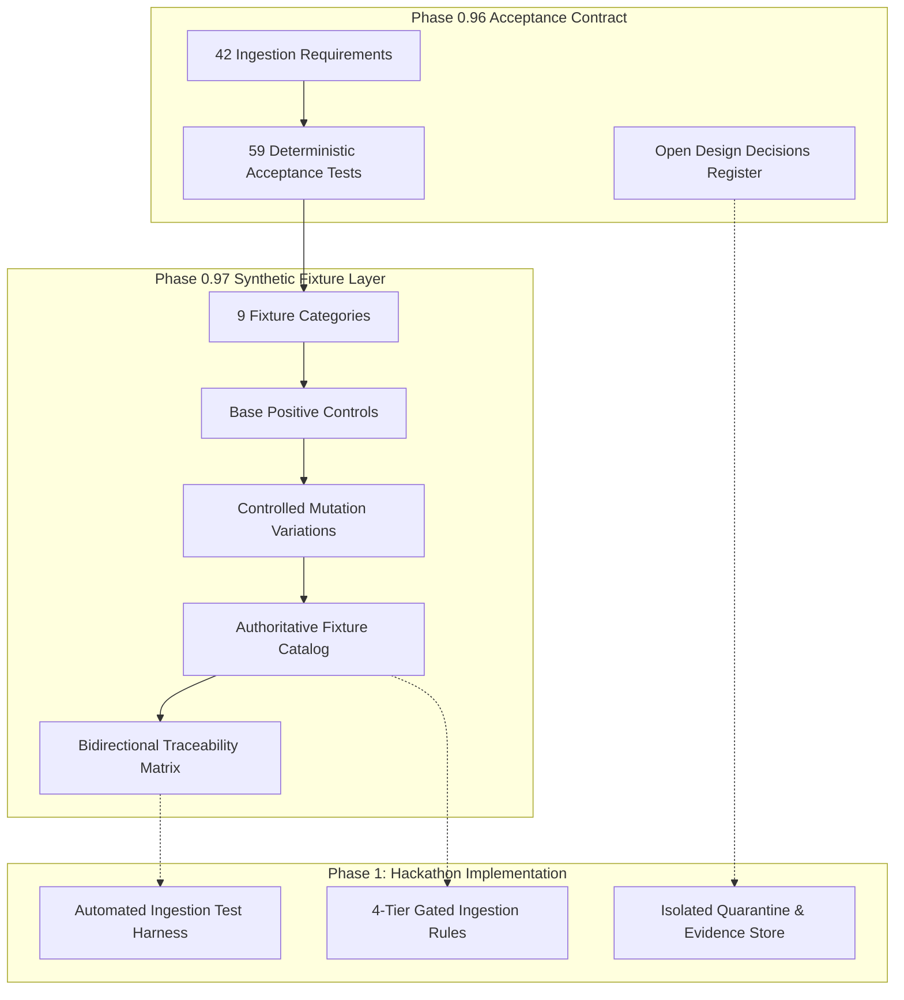
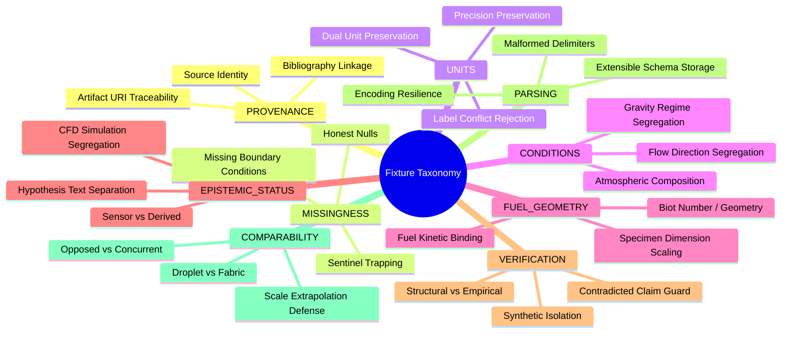
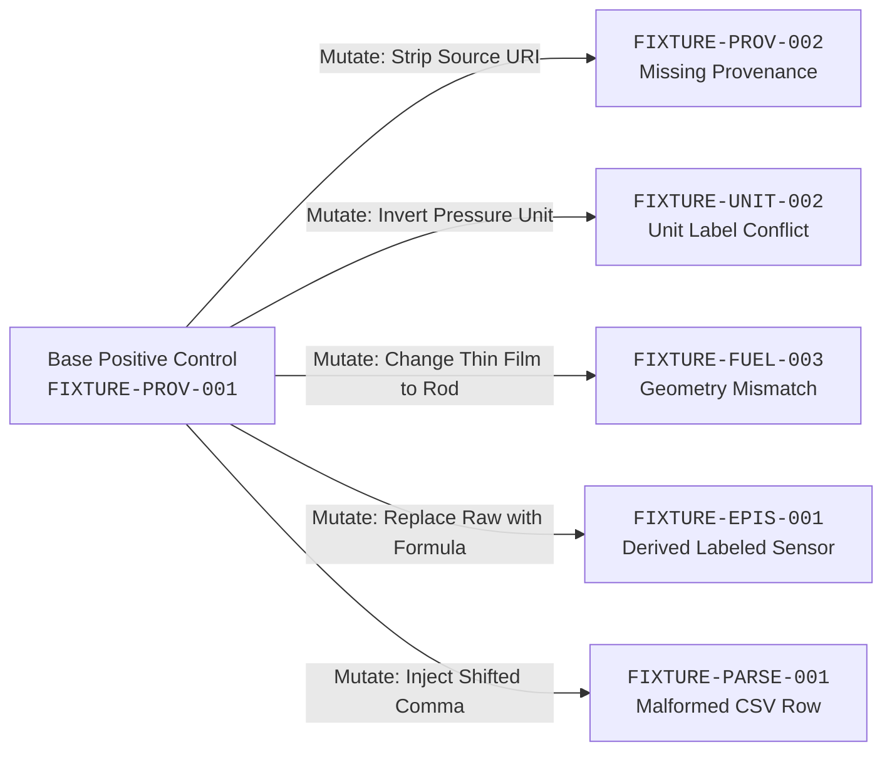
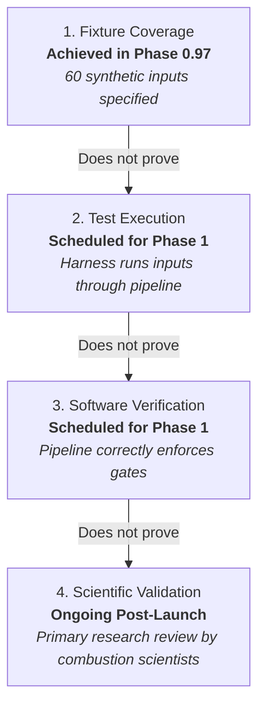

# Scientific Fixture Design & Test Data Contract Specification

**Phase**: 0.97 — Scientific Fixture Design & Test Data Contract  
**Project**: FIRELINE — Fire Intelligence & Research Evidence Linkage Engine  
**Agency**: CIPHER — *Decode. Build. Evolve.*  
**Author**: Lead Systems Architect & Scientific Data Engineer  
**Date**: October 11, 2026  
**Status**: Authoritative Specification (*Pre-event documentation only — design contract for future testing; no executable test harness or pipeline code*)  
**Previous Phase**: Phase 0.96 — Scientific Data Ingestion Test Specification (`05c702e`)

---

## 1. Executive Summary & Mission

### 1.1 Mission Statement
The central objective of Phase 0.97 is to establish a deterministic, implementation-independent, and scientifically safe fixture design contract for FIRELINE. 

Phase 0.96 defined the expected behavior of FIRELINE's scientific data ingestion system across 59 acceptance tests, 42 critical requirements, and 9 test families. Phase 0.97 turns those acceptance criteria into concrete synthetic input designs, defining the test payloads, synthetic identity boundaries, metadata schemas, and assertion contracts required to test the future ingestion pipeline without inventing or misrepresenting scientific truth.



### 1.2 Boundary Invariants & Pre-Event Restrictions
In strict adherence to the NASA Space Apps Challenge 2026 rules and FIRELINE's project governance:
1. **Specification Only**: This document defines the design and schema of synthetic test fixtures. No Python test runner, pytest suite, parser script, Supabase database table, or application endpoint has been implemented.
2. **Absolute Competition Freeze**: Full software implementation remains strictly frozen until the official hackathon window opens on November 14, 2026.
3. **Canonical HCO Protection**: The canonical schema defined in `hco_schema_specification.md` remains 100% untouched. Proposed schema extensions are explicitly marked `PROPOSED — SCHEMA DECISION REQUIRED`.
4. **No Simulated NASA Truth**: Synthetic test records use invented parameters and explicit synthetic namespaces. Under no circumstances may a synthetic test record be represented as genuine NASA Physical Sciences Informatics (PSI) flight telemetry.

---

## 2. Core Fixture Design Principles

Every fixture in FIRELINE's testing ecosystem must strictly obey six foundational architectural principles.

### 2.1 Synthetic-Data Identity
Every fixture carries an indelible synthetic identity that must survive file deserialization, structural parsing, schema validation, normalization, and test execution.
* **Identifier Convention**: Stable, category-prefixed identifier pattern:  
  `FIXTURE-{CATEGORY}-{NNN}` (e.g. `FIXTURE-UNITS-001`, `FIXTURE-PROV-002`).
* **Mandatory Synthetic Watermark**: Every fixture payload carries the explicit metadata marker:
  ```json
  "synthetic_designation": "SYNTHETIC TEST DATA — NOT NASA MEASUREMENTS",
  "is_synthetic": true,
  "empirical_eligibility": "NEVER_ELIGIBLE"
  ```
* **Loss of Synthetic Identity**: If an ingestion pipeline bug or schema transformation strips the `is_synthetic: true` flag or synthetic namespace, the record must be immediately dropped and quarantined by Gate 10 (Synthetic Isolation Gate).

### 2.2 No False NASA Attribution
Synthetic fixtures are constructed to verify failure modes, edge cases, and unit conversions. They must never forge NASA provenance.
* **Separation of Four Domains**:
  1. *Verified Empirical Facts*: Documented findings verified from primary literature (e.g., Urban et al. 2019, Olson & Ferkul 2017).
  2. *Synthetic Test Payloads*: Deliberately fabricated numbers designed to trip validation gates.
  3. *Unresolved Scientific Questions*: Discrepancies preserved in the open decision register (e.g., Saffire-I thickness conflict).
  4. *Expected System Behaviors*: Defined dispositions (`ACCEPT`, `REJECT`, `QUARANTINE`, `REQUIRE_REVIEW`).
* **Synthetic Namespace Standard**:
  * Synthetic Investigations: `SYNTHETIC-INV-XXX` (never `PSI-69`, `PSI-25`, or `PSI-98` in fabricated payloads).
  * Synthetic Runs: `SYNTHETIC-RUN-XXX` (never actual flight run numbers).
  * Synthetic Artifact URNs: `urn:fireline:synthetic:artifact:{category}:{id}`.

### 2.3 Deterministic Outcomes
Given a specific fixture payload, canonical schema version, and validation policy, the ingestion engine must produce an identical outcome across 100% of runs.
* Expected outcomes must not rely on system clock timestamps, random UUID generation, external network requests, live NASA portal scraping, or non-deterministic LLM evaluation.
* Surrogate key generation for fixtures must follow deterministic hashing:
  $$\text{Key} = \text{SHA256}(\text{FixtureID} \parallel \text{Category} \parallel \text{PayloadVersion})[:16]$$

### 2.4 Scientific Plausibility Without Simulated Truth
Fixtures are designed with physically reasonable orders of magnitude (e.g., ambient pressures between $10\text{ kPa}$ and $200\text{ kPa}$, oxygen fractions between $0.10$ and $0.50$, flow speeds between $0$ and $100\text{ cm/s}$) so that physical sanity checks are exercised.
* However, physical plausibility does not constitute physical truth.
* A passing fixture demonstrates that the parser, validator, and conversion rules behaved as designed. It does not validate the underlying physical combustion model.

### 2.5 No Silent Correction
The test fixtures exist specifically to ensure that the future ingestion pipeline never silently alters corrupted or ambiguous scientific inputs.
* Conflicting unit labels (e.g., $14.7\text{ kPa}$ labeled as cabin pressure) must halt ingestion, not be silently multiplied by $6.894$.
* Discrepant specimen dimensions ($0.37\text{ cm}$ vs. $0.4\text{ mm}$) must trigger `REQUIRE_REVIEW`, not be silently divided by 10.
* Empty cells must remain `null`, not be silently populated with `0.0`.
* Missing flow velocity in quiescent droplet experiments must not be silently imputed as forced convection zero.

### 2.6 Canonical Schema Protection
The canonical schema defined in `hco_schema_specification.md` is the authoritative reference.
* Where a fixture tests a capability proposed in `docs/hco_schema_change_proposal.md` (such as `ScientificValue<T>` or nullable `flow_velocity_cm_s`), the fixture must explicitly state:  
  `PROPOSED — SCHEMA DECISION REQUIRED (DEC-02)`.
* Canonical fields are never modified to force a fixture to pass.

---

## 3. Fixture Taxonomy

The 60 fixtures in FIRELINE's catalog are organized into **9 functional categories** aligning with the acceptance test families established in Phase 0.96.



| Category | Identifier Tag | Purpose & Scope | Target Test Family |
| :--- | :--- | :--- | :--- |
| **1. Provenance** | `PROV` | Validates source attribution, DOI verification, table coordinates, artifact URIs, and duplicate detection. | Family A (`TEST-A01` to `A07`) |
| **2. Missingness** | `MISS` | Verifies honest null representation, sentinel conversion (`-999.0` to `null`), and bans silent zero substitution. | Family B (`TEST-B01` to `B08`) |
| **3. Units & Precision** | `UNIT` | Tests mathematical conversion traceability, unit-label conflicts, precision preservation, and uncalibrated display handling. | Family C (`TEST-C01` to `C09`) |
| **4. Conditions** | `COND` | Enforces segregation of flow directions (opposed vs concurrent), gravity regimes ($1g$ vs $\mu g$), and atmospheric pressures. | Family D (`TEST-D01` to `D06`) |
| **5. Fuel & Geometry** | `FUEL` | Prevents cross-fuel kinetic conflation (Methanol vs Heptane) and geometry mismatches (thin films vs thick cylindrical rods). | Family E (`TEST-E01` to `E06`) |
| **6. Epistemic Status** | `EPIS` | Enforces explicit labeling of sensor measurements, derived estimates, CFD simulations, and proposal hypotheses. | Family F (`TEST-F01` to `F06`) |
| **7. Verification & Isolation**| `VERIF`| Guarantees 100% quarantine of synthetic fixtures from production evidence indices; decouples syntactic validity from truth. | Family G (`TEST-G01` to `G06`) |
| **8. Parsing Integrity** | `PARSE`| Tests handling of shifted delimiters, corrupted headers, non-UTF-8 encodings, and extensible metadata extraction. | Family H (`TEST-H01` to `H06`) |
| **9. Comparability** | `COMP` | Prohibits ungrounded scientific comparisons across incompatible combustion regimes, fuel chemistries, or physical scales. | Family I (`TEST-I01` to `I06`) |

---

## 4. Fixture Anatomy & Metadata Standard

Every fixture in [`docs/phase097_fixture_catalog.md`](phase097_fixture_catalog.md) follows a standardized specification schema:

```json
/* FIXTURE METADATA SPECIFICATION SCHEMA */
{
  "fixture_id": "FIXTURE-{CATEGORY}-{NNN}",
  "name": "Human-readable fixture title",
  "category": "PROVENANCE | MISSINGNESS | UNITS | CONDITIONS | FUEL_GEOMETRY | EPISTEMIC_STATUS | VERIFICATION | PARSING | COMPARABILITY",
  "synthetic_label": "SYNTHETIC TEST DATA — NOT NASA MEASUREMENTS",
  "purpose": "Precise explanation of the ingestion rule or failure mode tested",
  "target_tests": ["TEST-X01", "TEST-X02"],
  "target_requirements": ["REQ-INGEST-XX"],
  "input_format": "JSON | CSV | TABULAR_SNIPPET",
  "base_fixture": "FIXTURE-BASE-001 | null",
  "mutation_description": "Description of single controlled modification from base fixture, if applicable",
  "payload": {
    /* Exact synthetic test record */
  },
  "preconditions": "Required parser state, registry entries, or schema settings",
  "expected_disposition": "ACCEPT | REJECT | QUARANTINE | REQUIRE_REVIEW | OPEN",
  "expected_reason_code": "INGEST_CODE_XX (e.g., ERR_UNIT_CONFLICT, WARN_UNVERIFIED_SOURCE)",
  "preservation_rules": "List of raw source fields that must remain immutable through ingestion",
  "empirical_eligibility": "NEVER_ELIGIBLE",
  "open_decisions": ["DEC-XX"] | [],
  "implementation_status": "DESIGN ONLY — NOT IMPLEMENTED OR EXECUTED"
}
```

---

## 5. Base-Fixture & Controlled Mutation Architecture

To maximize test maintainability and prevent combinatorial explosion, FIRELINE employs a **Base-Fixture & Controlled Mutation Architecture**.



### 5.1 The Base Positive Control
A single canonical baseline record (`FIXTURE-PROV-001`) defines a structurally, physically, and provenance-wise flawless synthetic record:
* Valid synthetic investigation (`SYNTHETIC-INV-001`).
* Valid synthetic artifact URN (`urn:fireline:synthetic:artifact:table:001`).
* Explicit boundary conditions ($P = 101.3\text{ kPa}, X_{O_2} = 0.21, u_\infty = 20.0\text{ cm/s}, g = 0\text{ m/s}^2$).
* Dual-unit preservation with exact conversion provenance.
* Explicit synthetic watermark.

### 5.2 The Fault Isolation Rule
When constructing negative test variations:
1. **Single-Fault Principle**: A fixture testing unit conversion must not simultaneously contain missing provenance or shifted CSV columns.
2. **Deterministic Attribution**: If a test fails, the failure must be unambiguously attributable to the specific mutation introduced.
3. **Compound Fixtures**: Compound interaction fixtures (e.g. testing the simultaneous interaction of non-UTF-8 characters with unmapped columns) are permitted only when explicitly categorized as Interaction Tests.

---

## 6. Future Fixture Execution Contract

When software development commences in Phase 1, the test harness must execute fixtures according to the following invariants:

### 6.1 Input Immutability
The ingestion engine must treat the fixture payload as read-only. Deserializers and validators must operate on deep copies. Any mutation of raw source strings or original values during normalization is a critical harness violation.

### 6.2 Reproducible Assertion Contracts
Every test execution must verify four discrete assertion layers:
1. **Disposition Check**: `actual.disposition == expected.disposition`.
2. **Reason Code Check**: `actual.reason_code == expected.reason_code`.
3. **Immutability Check**: `actual.raw_value == expected.raw_value` and `actual.raw_unit == expected.raw_unit`.
4. **Quarantine Check**: If `expected.disposition != ACCEPT`, verify that `actual.id` is absent from production view `v_verified_empirical_findings`.

### 6.3 Standardized Future Test Execution Report Format
The automated test runner will be required to output execution telemetry adhering to the following contract:
```json
/* FUTURE TEST EXECUTION REPORT SCHEMA (PHASE 1 IMPLEMENTATION) */
{
  "execution_id": "RUN-20261114-001",
  "fixture_id": "FIXTURE-UNIT-002",
  "target_test_id": "TEST-C02",
  "target_requirement_id": "REQ-INGEST-13",
  "schema_version": "hco-v1.0.0-canonical",
  "policy_version": "ingest-policy-2026.1",
  "status": "PASSED | FAILED",
  "expected": {
    "disposition": "REJECT",
    "reason_code": "ERR_UNIT_LABEL_CONFLICT"
  },
  "actual": {
    "disposition": "REJECT",
    "reason_code": "ERR_UNIT_LABEL_CONFLICT"
  },
  "immutability_verified": true,
  "isolation_verified": true,
  "execution_duration_ms": 1.2
}
```

---

## 7. Protection Against False Test Confidence

To maintain scientific integrity across FIRELINE's development lifecycle, we explicitly document the fundamental limits of synthetic fixture testing:



### Critical Epistemic Distinctions:
1. **Fixture Coverage $\ne$ Test Execution**: Designing 60 synthetic fixtures proves that test inputs have been rigorously planned. It does not prove that software has run or passed.
2. **Software Verification $\ne$ Scientific Validation**: Verifying that a software validator rejects $14.7\text{ kPa}$ cabin pressure proves that code logic works. It does not validate the underlying physical flammability limits of spacecraft materials.
3. **Synthetic Records $\ne$ NASA Flight Truth**: Synthetic fixtures are tools for software quality engineering. They must never be indexed, retrieved, or cited in support of actual spacecraft fire safety assessments.

---

## 8. Summary of Document Relationships

* [`docs/phase097_fixture_catalog.md`](phase097_fixture_catalog.md): The authoritative inventory of 60 deterministic fixtures with explicit synthetic payloads.
* [`docs/phase097_fixture_traceability_matrix.md`](phase097_fixture_traceability_matrix.md): Bidirectional mapping connecting all 42 requirements and 59 tests to the fixture catalog.
* [`docs/phase097_open_fixture_design_decisions.md`](phase097_open_fixture_design_decisions.md): Analysis of architectural and scientific decisions impacting fixture execution.
* [`FIRELINE-Home.md`](../FIRELINE-Home.md): Central knowledge base navigation and project status tracker.
