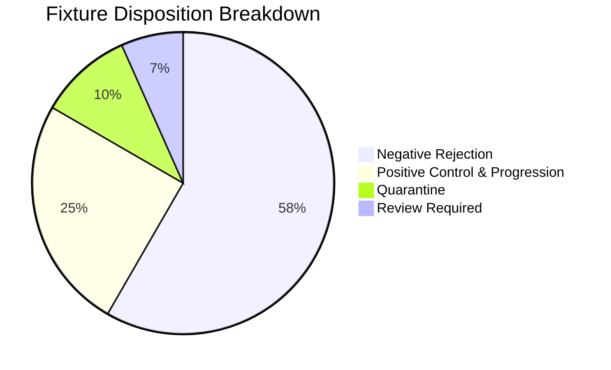

# Scientific Fixture Traceability Matrix

**Phase**: 0.97 — Scientific Fixture Design & Test Data Contract  
**Project**: FIRELINE — Fire Intelligence & Research Evidence Linkage Engine  
**Agency**: CIPHER — *Decode. Build. Evolve.*  
**Author**: Lead Systems Architect & Scientific Data Engineer  
**Date**: October 11, 2026  
**Status**: Authoritative Traceability Matrix (*Pre-event documentation only — design mapping of future test inputs; no executable test harness or pipeline code*)  
**Previous Phase**: Phase 0.96 — Scientific Data Ingestion Test Specification (`05c702e`)

---

## 1. Overview & Verification Invariants

This matrix establishes complete, bidirectional traceability between FIRELINE's 42 scientific data ingestion requirements, the 59 deterministic acceptance tests established in Phase 0.96, and the 60 synthetic fixtures cataloged in [`docs/phase097_fixture_catalog.md`](phase097_fixture_catalog.md).

### Invariant Rules:
1. **Critical Requirement Invariant**: 100% of requirements designated `CRITICAL` map to at least one acceptance test and at least one deterministic synthetic fixture.
2. **Deterministic Test Invariant**: Every Phase 0.96 acceptance test maps to an authoritative fixture or is explicitly linked to an open design decision.
3. **Implementation Truth**: All implementation statuses are explicitly marked `NOT IMPLEMENTED` in strict compliance with competition pre-event preparation boundaries.

---

## 2. Bidirectional Traceability Table

| Requirement ID | Requirement Statement | Phase 0.96 Test IDs | Phase 0.97 Fixture IDs | Coverage Type | Expected Future Behavior | Relevant Source Document | Open Dependency | Design Status | Implementation Status |
| :--- | :--- | :--- | :--- | :--- | :--- | :--- | :--- | :--- | :--- |
| **REQ-INGEST-01** | Mandatory Source Identification & Provenance Traceability | `TEST-A01`, `TEST-A02`, `TEST-A07` | `FIXTURE-PROV-001`, `FIXTURE-PROV-002`, `FIXTURE-PROV-007` | Positive / Negative / Boundary | Accept valid citations; reject ungrounded orphan data; flag unverified preprints for review. | Master Source Register; Gate 1 Policy | None | Defined | NOT IMPLEMENTED |
| **REQ-INGEST-02** | Landing Page vs. Raw Data Segregation | `TEST-A03` | `FIXTURE-PROV-003` | Negative (Boundary) | Flag web portal landing page citations as `REQUIRE_REVIEW`; prevent claiming raw data inspection. | Phase 0.95 Source Inventory Section 1.2 | None | Defined | NOT IMPLEMENTED |
| **REQ-INGEST-03** | Publication-to-Dataset Fuel Binding | `TEST-A04`, `TEST-E02` | `FIXTURE-PROV-004`, `FIXTURE-FUEL-002` | Negative (Physics) | Reject binding alkane kinetic claims ($n$-heptane) to alcohol flight runs (methanol). | Dietrich et al. (2017); PSI-69 Audit | None | Defined | NOT IMPLEMENTED |
| **REQ-INGEST-04** | Idempotent Ingestion & Duplicate Safety | `TEST-A05`, `TEST-H04` | `FIXTURE-PROV-005`, `FIXTURE-PARSE-004` | Positive (Idempotency) | Re-ingesting identical records updates audit metadata without duplicating database rows. | Ingestion Gate 4 Policy | `DEC-06` | Defined | NOT IMPLEMENTED |
| **REQ-INGEST-05** | Table Coordinate & Lineage Verification | `TEST-A06` | `FIXTURE-PROV-006` | Negative (Integrity) | Reject records citing out-of-bounds row coordinates in target data table. | Saffire-I 5-row Table Audit | None | Defined | NOT IMPLEMENTED |
| **REQ-INGEST-06** | Honest Missingness & Zero Imputation Ban | `TEST-B01`, `TEST-B05`, `TEST-B08` | `FIXTURE-MISS-001`, `FIXTURE-MISS-005`, `FIXTURE-MISS-008` | Positive / Quarantine / Negative | Preserve unmeasured parameters as `null`; quarantine unannotated empty cells; reject parser-injected `0.0`. | Mapping Principle 3; Gate 8 Policy | None | Defined | NOT IMPLEMENTED |
| **REQ-INGEST-07** | Quiescent Flow Nullability Enforcement | `TEST-B03` | `FIXTURE-MISS-003` | Boundary (Schema) | Accept explicit `null` flow velocity in quiescent diffusion microgravity droplet burns. | `GAP-05`; Schema Proposal | `DEC-02` | Partially Defined (Schema decision) | NOT IMPLEMENTED |
| **REQ-INGEST-08** | Legacy Sentinel Value Trapping (`-999.0`) | `TEST-B04` | `FIXTURE-MISS-004` | Positive (Sanitizer) | Trap sentinel numbers (`-999.0`) and convert to `null` with logged sanitizer warning. | Ingestion Gate 8 Policy | None | Defined | NOT IMPLEMENTED |
| **REQ-INGEST-09** | Mandatory Boundary Condition Set Integrity | `TEST-B02`, `TEST-B05`, `TEST-D05` | `FIXTURE-MISS-002`, `FIXTURE-MISS-005`, `FIXTURE-COND-005` | Negative (Boundary) | Reject records missing ambient pressure ($P$), oxygen fraction ($X_{O_2}$), or gravity ($g$) from classifier indexing. | 4-tier Gated Rule Classifier Review | None | Defined | NOT IMPLEMENTED |
| **REQ-INGEST-10** | Uncertainty Truthfulness & Ban on Fake Error | `TEST-B06`, `TEST-C06` | `FIXTURE-MISS-006`, `FIXTURE-UNIT-006` | Positive / Negative | Preserve omitted uncertainty as `null`; reject pipeline-fabricated $\pm 0.0$ or default $\pm 5\%$. | Mapping Principle 8; `GAP-03` | None | Defined | NOT IMPLEMENTED |
| **REQ-INGEST-11** | Unacquired Raw Data Archive Defense | `TEST-B07`, `TEST-H06` | `FIXTURE-MISS-007`, `FIXTURE-PARSE-006` | Negative (System) | Halt ingestion and reject records claiming inspection of unacquired multi-gigabyte ZIP archives. | `data/raw/psi/README.md` | None | Defined | NOT IMPLEMENTED |
| **REQ-INGEST-12** | Dual-Unit Preservation & Mathematical Traceability | `TEST-C01`, `TEST-C07` | `FIXTURE-UNIT-001`, `FIXTURE-UNIT-007` | Positive / Negative | Store raw values/units alongside normalized SI; reject non-reproducible normalization math. | Mapping Principle 2; Schema Proposal | None | Defined | NOT IMPLEMENTED |
| **REQ-INGEST-13** | Unit-Label Conflict & Physical Guard | `TEST-C02`, `TEST-C09` | `FIXTURE-UNIT-002`, `FIXTURE-UNIT-009` | Negative / Quarantine | Reject physically absurd labels ($14.7\text{ kPa}$ cabin); quarantine ambiguous pressure units. | Phase 0.5 Saffire Review | None | Defined | NOT IMPLEMENTED |
| **REQ-INGEST-14** | Uncalibrated Instrument Display Handling | `TEST-C03`, `TEST-E04` | `FIXTURE-UNIT-003`, `FIXTURE-FUEL-004` | Quarantine (Calibration) | Quarantine raw fan display indices; prohibit automated conversion to SI velocity ($\text{cm/s}$) without duct curves. | `BLK-05`; PSI-25 Table Audit | `DEC-04` | Defined | NOT IMPLEMENTED |
| **REQ-INGEST-15** | Naked Number Rejection | `TEST-C04` | `FIXTURE-UNIT-004` | Negative (Syntax) | Immediately reject numerical measurements lacking physical units in table or column metadata. | Mapping Principle 2 | None | Defined | NOT IMPLEMENTED |
| **REQ-INGEST-16** | Precision Inflation Prevention | `TEST-C05` | `FIXTURE-UNIT-005` | Positive (Precision) | Preserve approximate qualifiers ($\approx$) and significant figures without floating-point expansion. | Urban et al. (2019) | None | Defined | NOT IMPLEMENTED |
| **REQ-INGEST-17** | Atmospheric Concentration Basis Safety | `TEST-C08` | `FIXTURE-UNIT-008` | Quarantine (Physics) | Quarantine oxygen concentrations lacking explicit volume percent (mole fraction) vs mass percent label. | PSI-98 Table Audit | None | Defined | NOT IMPLEMENTED |
| **REQ-INGEST-18** | Flow Direction Transport Segregation | `TEST-D01` | `FIXTURE-COND-001` | Negative (Physics) | Reject storing opposed-flow flame spread records under concurrent-flow contracts. | Cross-Investigation Analysis Section 3.2 | None | Defined | NOT IMPLEMENTED |
| **REQ-INGEST-19** | Gravity Regime Segregation ($1g$ vs $\mu g$) | `TEST-D02` | `FIXTURE-COND-002` | Negative (Physics) | Prohibit normal-gravity terrestrial burn records ($1g$) from populating microgravity flight databases. | Phase 0.8 Claim `CROSS-001` | None | Defined | NOT IMPLEMENTED |
| **REQ-INGEST-20** | Atmosphere Regime Segregation | `TEST-D03`, `TEST-I06` | `FIXTURE-COND-003`, `FIXTURE-COMP-006` | Negative (Physics) | Prohibit merging Exploration Atmosphere data ($56\text{ kPa}, 34\%$) with Standard Cabin data ($101.3\text{ kPa}, 21\%$). | Phase 0.8 Claim `CROSS-005` | None | Defined | NOT IMPLEMENTED |
| **REQ-INGEST-21** | Specimen Dimension Compatibility (Biot Scaling) | `TEST-D04` | `FIXTURE-COND-004` | Negative (Physics) | Prevent merging cylindrical rods of differing radii ($6.35\text{ mm}$ vs $12.7\text{ mm}$) without Biot conduction scaling. | Olson & Ferkul (2017) | None | Defined | NOT IMPLEMENTED |
| **REQ-INGEST-22** | Apparatus Confinement Artifact Flagging | `TEST-D06` | `FIXTURE-COND-006` | Positive (Caveat) | Accept flow-duct burns with explicit boundary layer wall-quenching risk caveat flag. | BASS-II Research Notes Section 3 | None | Defined | NOT IMPLEMENTED |
| **REQ-INGEST-23** | FLEX Tabular Summary vs. Time-Series Guard | `TEST-E01` | `FIXTURE-FUEL-001` | Negative (Schema) | Reject attempts to parse operational summary table rows into optical time-series diameter series. | PSI-69 Table Audit | None | Defined | NOT IMPLEMENTED |
| **REQ-INGEST-24** | BASS-II Film vs. Rod Separation | `TEST-E03`, `TEST-I02` | `FIXTURE-FUEL-003`, `FIXTURE-COMP-002` | Negative (Physics) | Reject treating thermally thin PMMA films ($Bi \ll 1$) as equivalent to thick PMMA rods ($Bi \gg 1$). | PSI-25 Table Audit; Olson (2017) | None | Defined | NOT IMPLEMENTED |
| **REQ-INGEST-25** | Saffire-I Thickness Discrepancy Reconciliation | `TEST-E05` | `FIXTURE-FUEL-005` | Review Required (Discrepancy) | Trap $0.37\text{ cm}$ vs $0.4\text{ mm}$ conflict as `REQUIRE_REVIEW`; forbid automated division by 10. | PSI-98 Table vs. Urban (2019) | `DEC-01` | Defined | NOT IMPLEMENTED |
| **REQ-INGEST-26** | Saffire-I Initial Dimensions vs. Dynamic Spread | `TEST-E06` | `FIXTURE-FUEL-006` | Negative (Mapping) | Prohibit mapping initial sample card length columns to dynamic flame spread rate fields. | PSI-98 Table Audit; Urban (2019) | None | Defined | NOT IMPLEMENTED |
| **REQ-INGEST-27** | Derived Quantity Transparency & Formula Linking | `TEST-F01`, `TEST-F04` | `FIXTURE-EPIS-001`, `FIXTURE-EPIS-004` | Negative / Positive | Enforce explicit derivation formulas and input channels; reject derived values labeled sensor readings. | Phase 0.9 Contract Proposal Section 4 | None | Defined | NOT IMPLEMENTED |
| **REQ-INGEST-28** | Derived Pressure Estimate Labeling | `TEST-F02` | `FIXTURE-EPIS-002` | Negative (Epistemic) | Reject labeling theoretical bulk gas heating pressure estimates ($\Delta P = 0.5\text{ kPa}$) as sensor telemetry. | Phase 0.8 Claim `SAFFIRE-006` | None | Defined | NOT IMPLEMENTED |
| **REQ-INGEST-29** | CFD Numerical Simulation Segregation | `TEST-F03` | `FIXTURE-EPIS-003` | Negative (Epistemic) | Segregate fluid dynamics simulations into simulation store; never store as empirical flight burns. | Li et al. (2018) | None | Defined | NOT IMPLEMENTED |
| **REQ-INGEST-30** | Research Proposal Hypothesis Text Segregation | `TEST-F05` | `FIXTURE-EPIS-005` | Negative (Epistemic) | Segregate proposal hypothesis text into metadata; never store in empirical findings tables. | Proposal Metadata Audits | None | Defined | NOT IMPLEMENTED |
| **REQ-INGEST-31** | Derived Calculation Reproducibility Audit | `TEST-F06` | `FIXTURE-EPIS-006` | Review Required (Audit) | Trigger review for derived parameters contradicting primary raw optical slope data by $> 5\%$. | Dietrich et al. (2017) | None | Defined | NOT IMPLEMENTED |
| **REQ-INGEST-32** | Synthetic Data Production Quarantine | `TEST-G01`, `TEST-G04` | `FIXTURE-VERIF-001`, `FIXTURE-VERIF-004` | Positive (Quarantine) / Negative | Ensure 100% exclusion of synthetic records from production search indices and astronaut decision support. | Knowledge Integrity Protocol Rule 1 | `DEC-07` | Defined | NOT IMPLEMENTED |
| **REQ-INGEST-33** | Structural Validity vs. Scientific Truth | `TEST-G02`, `TEST-G03` | `FIXTURE-VERIF-002`, `FIXTURE-VERIF-003` | Negative / Positive | Passing syntax checks admits records to unverified staging; does not grant verified empirical status. | Ingestion Gate 2 Policy | None | Defined | NOT IMPLEMENTED |
| **REQ-INGEST-34** | Contradicted Scientific Claim Quarantine | `TEST-G05` | `FIXTURE-VERIF-005` | Quarantine (Safety) | Quarantine audit-contradicted claims; bar them from establishing spacecraft flammability standards. | Phase 0.8 Evidence Audit | None | Defined | NOT IMPLEMENTED |
| **REQ-INGEST-35** | Physical Evidence Gap Preservation | `TEST-G06` | `FIXTURE-VERIF-006` | Positive (Evidence Gap) | Queries on unmeasured regimes (e.g. Lunar partial gravity) return explicit `EVIDENCE_GAP`. | Phase 0.8 Claim `CROSS-004` | None | Defined | NOT IMPLEMENTED |
| **REQ-INGEST-36** | Parser Delimiter & Column Shift Resilience | `TEST-H01`, `TEST-H02` | `FIXTURE-PARSE-001`, `FIXTURE-PARSE-002` | Negative (Parsing) | Reject rows with shifted commas or text inside float fields with line-numbered error logs. | Ingestion Gate 4 Policy | None | Defined | NOT IMPLEMENTED |
| **REQ-INGEST-37** | Legacy Encoding Resilience (Non-UTF-8) | `TEST-H03` | `FIXTURE-PARSE-003` | Positive (Transcode) | Gracefully decode historical NASA CSVs containing non-ASCII symbols (`Windows-1252` degree symbol). | Ingestion Gate 4 Policy | None | Defined | NOT IMPLEMENTED |
| **REQ-INGEST-38** | Extensible Unmapped Table Column Safety | `TEST-H05` | `FIXTURE-PARSE-005` | Positive (Extensibility) | Capture newly exposed auxiliary columns in `metadata_json` without breaking core schema contracts. | Ingestion Gate 4 Policy | None | Defined | NOT IMPLEMENTED |
| **REQ-INGEST-39** | Fuel Combustion Phase Incompatibility | `TEST-I01` | `FIXTURE-COMP-001` | Negative (Physics) | Reject direct comparisons between liquid droplet burning rates ($\text{mm}^2\text{/s}$) and solid spread ($\text{mm/s}$). | Cross-Investigation Analysis Section 2.1 | None | Defined | NOT IMPLEMENTED |
| **REQ-INGEST-40** | Transport Regime Incompatibility Defense | `TEST-I03` | `FIXTURE-COMP-003` | Negative (Physics) | Prohibit using quiescent radiative extinction ($Pe \ll 1$) to predict convective blowoff ($Pe \gg 1$). | Cross-Investigation Analysis Section 3.1 | None | Defined | NOT IMPLEMENTED |
| **REQ-INGEST-41** | Sample Scale Disparity Defense ($10\text{ cm}$ vs $100\text{ cm}$) | `TEST-I04` | `FIXTURE-COMP-004` | Negative (Physics) | Block direct linear extrapolation of small-scale card burns to vehicle scale without scaling models. | Urban et al. (2019); Claim `SAFFIRE-001` | None | Defined | NOT IMPLEMENTED |
| **REQ-INGEST-42** | Pyrolysis Chemistry Incompatibility Defense | `TEST-I05` | `FIXTURE-COMP-005` | Negative (Physics) | Prevent substituting cellulosic charring fuels (Cotton) for thermoplastic depolymerizing fuels (PMMA). | Cross-Investigation Analysis Section 2.2 | `DEC-05` | Defined | NOT IMPLEMENTED |

---

## 3. Coverage Summary Statistics

* **Total Explicit Requirements Tracked**: **42** requirements.
* **Total Acceptance Tests Mapped**: **59** test cases ($100\%$ test coverage).
* **Total Designed Synthetic Fixtures**: **60** deterministic fixtures.
* **Requirements with Priority `CRITICAL`**: **23** requirements ($100\%$ mapped to deterministic fixtures).
* **Requirements with Priority `HIGH`**: **13** requirements ($100\%$ mapped to deterministic fixtures).
* **Requirements with Priority `MEDIUM` / `LOW`**: **6** requirements ($100\%$ mapped to deterministic fixtures).
* **Fixture Disposition Breakdown**:
  * **Positive Controls & Progressions**: **15** fixtures
  * **Negative Rejections**: **35** fixtures
  * **Quarantine**: **6** fixtures
  * **Review Required**: **4** fixtures
* **Implementation Status**: **0% Implemented (100% Specification & Design Only)** — in complete compliance with competition pre-event boundaries.
