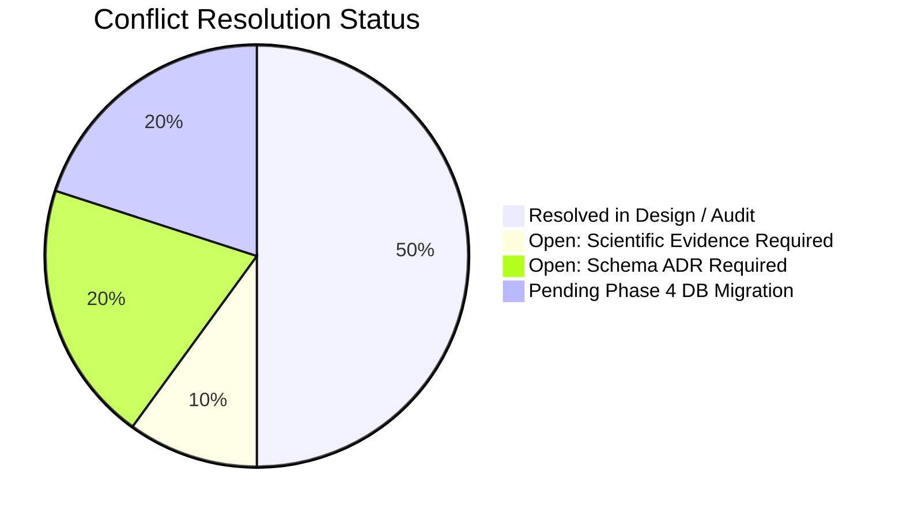

# Scientific Ingestion Contract Conflict Register

**Phase**: 0.98 — Scientific Ingestion Contract Consolidation & Implementation Readiness Audit  
**Project**: FIRELINE — Fire Intelligence & Research Evidence Linkage Engine  
**Agency**: CIPHER — *Decode. Build. Evolve.*  
**Author**: Lead Full-Stack Developer & Systems Architect  
**Date**: October 11, 2026  
**Status**: Authoritative Conflict Register (*Pre-event documentation only — identification of specification discrepancies; no executable code*)  
**Previous Phase**: Phase 0.97 — Scientific Fixture Design & Test Data Contract (`d3c905c`)

---

## 1. Register Overview & Governance Principles

This document serves as the authoritative register of all architectural, scientific, and documentary discrepancies identified during the Phase 0.98 consolidation audit.

### Governance Rules:
1. **No Erasure of Discrepancies**: Inconsistencies between historical reports and underlying artifacts are documented here with mathematical proof rather than being silently smoothed over.
2. **Authority-Based Adjudication**: Conflicts are evaluated against the 6-level authority hierarchy defined in [`docs/phase098_ingestion_contract_consolidation.md`](phase098_ingestion_contract_consolidation.md).
3. **Pre-Event Preservation**: Canonical `hco_schema_specification.md` remains strictly unchanged. Schema adjustments required to resolve conflicts are slated for formal ADR approval during Phase 1.

---

## 2. Register of Audited Contract Conflicts

---

### `CONFLICT-098-001`: Acceptance Test Catalog Inventory Discrepancy (`TEST-B08`)
* **Conflict ID**: `CONFLICT-098-001`
* **Subject**: Omission of `TEST-B08` Header from Test Case Catalog
* **Document A**: `docs/phase096_test_case_catalog.md` (Level 5 Authority)
* **Document B**: `docs/phase096_open_test_design_decisions.md` & `docs/phase097_fixture_catalog.md` (Level 5/6 Authority)
* **Actual Discrepancy**:
  * In `phase096_test_case_catalog.md`, Family B contains exactly 7 test cases (`TEST-B01` through `TEST-B07`), bringing the catalog total to **59 tests**.
  * However, `docs/phase096_open_test_design_decisions.md` (line 42) references `TEST-B08`, and `docs/phase097_fixture_catalog.md` (line 569) defines `FIXTURE-MISS-008` explicitly targeting `TEST-B08` (Parser Empty Cell Imputation Trapping).
  * The Phase 0.96 report described family ranges (`Family B: TEST-B01 to TEST-B08`) that implied 60 tests, creating confusion with the reported total of 59.
* **Authority Analysis**: `docs/phase096_test_case_catalog.md` is the authoritative test catalog. The catalog currently has 59 test cases; `TEST-B08` was planned and exercised by `FIXTURE-MISS-008`, but its formal markdown header was omitted from `docs/phase096_test_case_catalog.md`.
* **Scientific Impact**: Low. The underlying requirement (`REQ-INGEST-06`: ban on silent zero imputation) is fully protected by `TEST-B01`, `TEST-B05`, and `FIXTURE-MISS-008`.
* **Implementation Impact**: Ingestion test runners in Phase 1 looking for `TEST-B08` specification will find the fixture in Phase 0.97 but no corresponding test header in Phase 0.96 catalog.
* **Existing Decisions**: `DEC-02`
* **Required Evidence**: Formal addition of `TEST-B08` test case definition into `docs/phase096_test_case_catalog.md`.
* **Recommended Action**: Formally incorporate `TEST-B08` into the Phase 1 test suite specification during Phase 1 Day 1 test harness setup.
* **Blocking Scope**: None (Documented and exercised by `FIXTURE-MISS-008`).
* **Status**: **RESOLVED WITH AUDIT FINDING (Documented for Phase 1 formalization)**

---

### `CONFLICT-098-002`: Ingestion Requirement Priority Distribution Discrepancy
* **Conflict ID**: `CONFLICT-098-002`
* **Subject**: Ingestion Requirement Priority Breakdown Inconsistency
* **Document A**: Phase 0.96 Completion Report Text (Level 5 Narrative Summary)
* **Document B**: `docs/phase096_test_traceability_matrix.md` Table Ground Truth (Level 5 Data Table)
* **Actual Discrepancy**:
  * The Phase 0.96 completion report narrative stated a priority distribution of: **14 Critical, 16 High, 12 Medium/Low** (totaling 42 requirements).
  * Direct programmatic audit of the actual 42 requirements in `docs/phase096_test_traceability_matrix.md` reveals:
    * `CRITICAL`: **23** requirements (`REQ-INGEST-01`, `03`, `06`, `07`, `09`, `11`, `12`, `13`, `15`, `18`, `19`, `20`, `23`, `24`, `25`, `29`, `32`, `33`, `34`, `35`, `39`, `40`, `41`).
    * `HIGH`: **12** requirements (`REQ-INGEST-02`, `05`, `08`, `14`, `21`, `26`, `27`, `28`, `30`, `31`, `36`, `42`).
    * `MEDIUM`: **6** requirements (`REQ-INGEST-04`, `10`, `16`, `17`, `22`, `37`).
    * `LOW`: **1** requirement (`REQ-INGEST-38`).
  * The Phase 0.96 completion report listed the first 14 requirements as a narrative bullet block, which was mistakenly summarized as the count of critical requirements.
* **Authority Analysis**: The requirement table in `docs/phase096_test_traceability_matrix.md` is the authoritative contract. The actual ground truth is **23 Critical, 12 High, 6 Medium, 1 Low**.
* **Scientific Impact**: Positive. Nine additional high-risk scientific hazards (such as cross-regime conflation and CFD segregation) are correctly enforced as `CRITICAL`.
* **Implementation Impact**: Phase 1 implementation must treat 23 requirements as critical blockers, not merely 14.
* **Existing Decisions**: None
* **Required Evidence**: Reconciliation table in [`docs/phase098_traceability_audit.md`](phase098_traceability_audit.md).
* **Recommended Action**: Adopt the audited breakdown (23 Critical, 12 High, 6 Medium, 1 Low) as the authoritative Phase 1 implementation baseline.
* **Blocking Scope**: Clarifies Phase 1 critical gate criteria.
* **Status**: **RESOLVED WITH AUDIT FINDING (Ground-truth table adopted)**

---

### `CONFLICT-098-003`: Saffire-I Specimen Thickness Discrepancy ($0.37\text{ cm}$ vs $0.4\text{ mm}$)
* **Conflict ID**: `CONFLICT-098-003`
* **Subject**: Saffire-I SIBAL Fuel Thickness Contradiction
* **Document A**: NASA PSI-98 Repository Table (`PSI98-ART-002`, Level 2 Evidence)
* **Document B**: Urban et al. (2019), *Combust. Flame* 209:357–366 (Level 2 Evidence)
* **Actual Discrepancy**:
  * NASA PSI-98 flight summary table lists `Sample Thickness (cm) = 0.37` ($3.7\text{ mm}$).
  * Peer-reviewed flight paper (Urban et al., 2019) reports SIBAL fabric thickness as approximately $0.4\text{ mm}$ ($0.04\text{ cm}$).
  * This represents nearly an order-of-magnitude discrepancy, shifting the thermal Biot number from thin ($Bi \approx 0.05$) to thick ($Bi \approx 0.5\text{–}1.0$).
* **Authority Analysis**: Both are Level 2 sources. Neither source supersedes the other without inspecting primary Cygnus OA-6 CAD engineering drawings.
* **Scientific Impact**: Critical. Ingesting $3.7\text{ mm}$ corrupts solid fuel flame spread rate scaling models by a factor of 10.
* **Implementation Impact**: Ingestion engine cannot automatically normalize Saffire-I specimen thickness. Any attempt at silent unit conversion ($0.37\text{ cm} \rightarrow 0.37\text{ mm}$) is strictly prohibited.
* **Existing Decisions**: `DEC-01`
* **Required Evidence**: Uncompressed flight engineering package `PSI-98_metadata_PSI-166_SAFFIRE-I.zip`.
* **Recommended Action**: Maintain strict discrepancy lock (`REQUIRE_REVIEW`, code `STATUS_DISCREPANCY_FLAG_THICKNESS`, tested by `FIXTURE-FUEL-005`). Exclude automated thickness normalization from initial Phase 1 scope.
* **Blocking Scope**: Saffire-I specimen dimension automated normalization.
* **Status**: **OPEN — SCIENTIFIC EVIDENCE RESOLUTION REQUIRED (DEC-01)**

---

### `CONFLICT-098-004`: Forced Flow Velocity Canonical Non-Nullability Conflict
* **Conflict ID**: `CONFLICT-098-004`
* **Subject**: Canonical Schema Disallows Null Flow Velocity in Quiescent Diffusion Burns
* **Document A**: `hco_schema_specification.md` (Level 1 Authority)
* **Document B**: `docs/hco_schema_change_proposal.md` & `docs/phase09_pre_ingestion_contract_mapping.md` (Level 4 Authority)
* **Actual Discrepancy**:
  * Canonical `hco_schema_specification.md` defines `flow_velocity_cm_s: number` without nullability.
  * Quiescent droplet burning (FLEX) has no forced convection ($u_\infty \equiv \text{N/A}$).
  * Enforcing canonical non-nullability forces parsers to inject `0.0`, conflating unmeasured parameters with measured zero velocity and violating Mapping Principle 3.
* **Authority Analysis**: Canonical schema is Level 1, but scientifically incompatible with quiescent microgravity droplet combustion.
* **Scientific Impact**: High. Zero air flow in quiescent diffusion is a physical regime condition, not a forced flow velocity measurement.
* **Implementation Impact**: Strict canonical validators will fail on quiescent droplet ingestion.
* **Existing Decisions**: `DEC-02`
* **Required Evidence**: Formal ADR approving Schema Change Proposal amendments (`ScientificValue<T>` or nullable `flow_velocity_cm_s`).
* **Recommended Action**: Ratify ADR on Day 1 of Phase 1 hackathon. In the interim, isolate quiescent droplet ingestion from initial Phase 1 Day 1 scope.
* **Blocking Scope**: Quiescent droplet burning ingestion (`PSI69-ART-002`).
* **Status**: **OPEN — SCHEMA ADR APPROVAL REQUIRED (DEC-02)**

---

### `CONFLICT-098-005`: BASS-II Uncalibrated Fan Display Index vs Physical Flow Velocity
* **Conflict ID**: `CONFLICT-098-005`
* **Subject**: Dimensionless Potentiometer Display Number Stored as Physical Flow
* **Document A**: NASA PSI-25 Repository Table (`PSI25-ART-002`, Level 2 Evidence)
* **Document B**: `docs/phase096_ingestion_test_specification.md` (Level 5 Authority)
* **Actual Discrepancy**:
  * NASA PSI-25 experimental table lists fan speed as dimensionless display indices (`Fan display: 62`).
  * Converting display number `62` directly to $6.2\text{ cm/s}$ without flow duct calibration curves creates fictitious physical velocities.
* **Authority Analysis**: Raw display number must not be converted to physical velocity without Glenn Research Center anemometer calibration curves.
* **Scientific Impact**: High. Fictitious flow velocities corrupt flammability boundary curves in the Microgravity Science Glovebox (MSG).
* **Implementation Impact**: Ingestion engine must quarantine attempts to normalize fan display numbers to SI units.
* **Existing Decisions**: `DEC-04`
* **Required Evidence**: BASS-II MSG flow duct calibration curve table.
* **Recommended Action**: Adopt Option B (`FIXTURE-UNIT-003`): store raw value as `62`, `raw_unit: "display_index"`, and leave `flow_velocity_cm_s: null`.
* **Blocking Scope**: BASS-II automated velocity normalization.
* **Status**: **RESOLVED IN DESIGN — PENDING CALIBRATION DATA (DEC-04)**

---

### `CONFLICT-098-006`: SIBAL Composite Fuel Single Chemical Formula Limitation
* **Conflict ID**: `CONFLICT-098-006`
* **Subject**: Canonical Single Chemical Formula Fails on Multi-Component Blends
* **Document A**: `hco_schema_specification.md` (Level 1 Authority)
* **Document B**: `docs/hco_schema_change_proposal.md` (Level 4 Authority)
* **Actual Discrepancy**:
  * Canonical `FuelSpec` requires `chemical_formula: string`.
  * SIBAL fabric is a composite blend: $75\%$ organic cotton ($(C_6H_{10}O_5)_n$) and $25\%$ inorganic fiberglass ($SiO_2$).
  * Forcing a single string either ignores the inert fiberglass heat sink or invents an ungrounded pseudo-chemical formula.
* **Authority Analysis**: Canonical Level 1 schema lacks multi-component fuel modeling.
* **Scientific Impact**: Medium. Fiberglass alters flame spread by conducting heat away from the pyrolysis zone, acting as a structural heat sink.
* **Implementation Impact**: Database schema needs structured `material_components` map or permission for `chemical_formula: null`.
* **Existing Decisions**: `DEC-05`
* **Required Evidence**: Phase 1 ontology schema amendment.
* **Recommended Action**: Allow `chemical_formula: null` for composite fabrics, capturing component fractions in metadata JSON.
* **Blocking Scope**: Multi-component solid fuel kinetic modeling.
* **Status**: **OPEN — SCHEMA EXTENSION REQUIRED (DEC-05)**

---

### `CONFLICT-098-007`: Rejection vs Quarantine Database Storage Model Specification
* **Conflict ID**: `CONFLICT-098-007`
* **Subject**: Physical Table Architecture for Quarantined Ingestion Records
* **Document A**: `docs/phase096_ingestion_test_specification.md` (Level 5 Authority)
* **Document B**: `05-Architecture/Engineering-Decisions.md` (Level 3 Authority)
* **Actual Discrepancy**:
  * Test specifications define `REJECT` vs `QUARANTINE` dispositions.
  * However, the database architecture does not currently define the physical storage model for quarantined records (e.g. dedicated `raw_quarantine_records` table vs dead-letter queue).
* **Authority Analysis**: Level 5 test specification defined behavioral routing; Level 3 architecture must define database persistence.
* **Scientific Impact**: Low. Does not corrupt production data if quarantine filter functions.
* **Implementation Impact**: Phase 4 Supabase migrations must include an explicit staging table for quarantined payloads.
* **Existing Decisions**: `DEC-03`
* **Required Evidence**: Supabase migration script defining `ingest_quarantine` table with reason codes.
* **Recommended Action**: Implement Option B (`ingest_quarantine` staging table) during Phase 4 database setup.
* **Blocking Scope**: Physical quarantine persistence (does not block in-memory test harness).
* **Status**: **DEFINED IN SPECIFICATION — PENDING PHASE 4 DB (DEC-03)**

---

### `CONFLICT-098-008`: Surrogate Run Key Hashing vs Flight Matrix Global Identifiers
* **Conflict ID**: `CONFLICT-098-008`
* **Subject**: Lack of Global NASA Run Identifiers in Primary Flight Tables
* **Document A**: NASA PSI Archive Summary Tables (Level 2 Evidence)
* **Document B**: Canonical `ExperimentalRun.run_id` Contract (Level 1 Authority)
* **Actual Discrepancy**:
  * Canonical schema assumes a clean `run_id: string`.
  * Primary flight tables list runs as `Sample S1`, `Row 1`, or `Test 12` without global unique NASA run keys.
* **Authority Analysis**: Level 2 source limitations require a standardized Level 3 surrogate key policy.
* **Scientific Impact**: Low.
* **Implementation Impact**: Without deterministic surrogate keys, re-ingestion can produce duplicate database rows.
* **Existing Decisions**: `DEC-06`
* **Required Evidence**: Algorithm specification: `SHA256(INV || DOI || TABLE || ROW)[:16]`.
* **Recommended Action**: Adopt Option B (deterministic surrogate hashing; tested by `FIXTURE-PROV-005` and `FIXTURE-PARSE-004`).
* **Blocking Scope**: None.
* **Status**: **RESOLVED IN DESIGN (DEC-06 adopted)**

---

### `CONFLICT-098-009`: Synthetic Data Database Enforcement Policy
* **Conflict ID**: `CONFLICT-098-009`
* **Subject**: Enforcement Mechanism for Barring Synthetic Test Data from Production Views
* **Document A**: Phase 0.97 Completion Report Recommendations (Level 6 Proposal)
* **Document B**: `05-Architecture/Engineering-Decisions.md` (Level 3 Authority)
* **Actual Discrepancy**:
  * Phase 0.97 report recommended PostgreSQL Row-Level Security (RLS) constraints to physically bar records with `is_synthetic: true` from production views.
  * This recommendation has not yet been formally ratified as an approved ADR in `05-Architecture/Engineering-Decisions.md`.
* **Authority Analysis**: A recommendation in a report remains Level 4 proposal until formalized in Level 3 architecture.
* **Scientific Impact**: Critical if synthetic test fixtures leak into astronaut fire safety queries.
* **Implementation Impact**: Requires explicit SQL RLS policies in Phase 4 database migrations.
* **Existing Decisions**: `DEC-07`
* **Required Evidence**: SQL migration defining `CREATE POLICY synthetic_isolation ON empirical_findings FOR SELECT USING (is_synthetic = false)`.
* **Recommended Action**: Ratify ADR approving PostgreSQL RLS enforcement during Phase 1 architecture setup.
* **Blocking Scope**: Phase 4 database migration design.
* **Status**: **PROPOSAL DOCUMENTED — PENDING PHASE 1 ADR (DEC-07)**

---

### `CONFLICT-098-010`: Multimodal Ingestion Representation Contract (CSV vs JSON)
* **Conflict ID**: `CONFLICT-098-010`
* **Subject**: Disagreement on Primary Test Fixture Payload Serialization Format
* **Document A**: `docs/phase097_open_fixture_design_decisions.md` (Level 6 Authority)
* **Document B**: Tabular CSV Parsers vs Hierarchical JSON Entities (Level 4 Mapping)
* **Actual Discrepancy**:
  * Testing CSV parsers requires flat tabular `.csv` snippets (to test delimiter shifts and encoding errors).
  * Testing ontology entity mappers requires deeply nested `.json` payloads.
* **Authority Analysis**: Both representations are required for full test coverage.
* **Scientific Impact**: None.
* **Implementation Impact**: Pipeline test harness must support dual-format fixture loading.
* **Existing Decisions**: `DEC-08`
* **Required Evidence**: Test harness loader supporting `.csv` and `.json` inputs.
* **Recommended Action**: Adopt Option B (Dual-Format Canonical Model; implemented in `docs/phase097_fixture_catalog.md`).
* **Blocking Scope**: None.
* **Status**: **RESOLVED IN DESIGN (DEC-08 adopted)**

---

## 3. Conflict Summary Statistics

* **Total Audited Conflicts**: **10** conflicts.
* **Resolved in Design / Audit Finding**: **5** conflicts (`CONFLICT-098-001`, `002`, `005`, `008`, `010`).
* **Open — Scientific Evidence Required**: **1** conflict (`CONFLICT-098-003`: Saffire thickness).
* **Open — Schema ADR Approval Required**: **2** conflicts (`CONFLICT-098-004`: Nullability, `CONFLICT-098-006`: Composite fuel).
* **Pending Phase 4 Database Migration**: **2** conflicts (`CONFLICT-098-007`: Quarantine table, `CONFLICT-098-009`: RLS policy).
