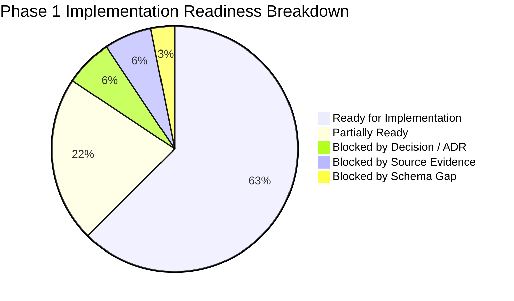

# Scientific Ingestion Implementation Readiness Checklist

**Phase**: 0.98 — Scientific Ingestion Contract Consolidation & Implementation Readiness Audit  
**Project**: FIRELINE — Fire Intelligence & Research Evidence Linkage Engine  
**Agency**: CIPHER — *Decode. Build. Evolve.*  
**Author**: Lead Full-Stack Developer & Systems Architect  
**Date**: October 11, 2026  
**Status**: Authoritative Readiness Checklist (*Pre-event documentation only — evaluation of implementation readiness; no executable code*)  
**Previous Phase**: Phase 0.97 — Scientific Fixture Design & Test Data Contract (`d3c905c`)

---

## 1. Checklist Overview & Readiness Definitions

This checklist translates FIRELINE's consolidated scientific data ingestion contracts into actionable readiness criteria across six core engineering domains.

### Documentary Readiness Classifications:
* **`READY_FOR_IMPLEMENTATION`**: The requirement, schema mapping, acceptance test, and fixture design are 100% unambiguous, documented, and unblocked. Implementation may begin immediately once the Phase 1 development window opens.
* **`PARTIALLY_READY`**: The core data structure and validation logic are defined, but minor auxiliary conventions (e.g. metadata naming or surrogate hashing) require confirmation during Phase 1 kickoff.
* **`BLOCKED_BY_DECISION`**: Implementation is blocked pending an architectural decision record (ADR) approval or policy consensus (e.g. `DEC-02` nullability, `DEC-07` RLS).
* **`BLOCKED_BY_SOURCE_EVIDENCE`**: Implementation of a specific investigation or normalization is blocked pending acquisition and inspection of primary NASA archives or CAD drawings (e.g. Saffire-I thickness).
* **`BLOCKED_BY_SCHEMA_GAP`**: Implementation is blocked because canonical `hco_schema_specification.md` currently lacks an entity or field needed to represent the physical concept (e.g. composite fuel blends).
* **`BLOCKED_BY_CONFLICT`**: Implementation is blocked due to an unresolved contradiction between earlier specifications.
* **`NOT_ASSESSED`**: Requirement belongs to a later phase and has not yet been audited for Phase 1 entry.

---

## 2. Group A: Repository and Engineering Foundation

| Checklist ID | Requirement Statement | Supporting Source Document | Relevant IDs | Readiness State | Reason for State | Condition Required to Mark Ready |
| :--- | :--- | :--- | :--- | :--- | :--- | :--- |
| **CHK-REPO-01** | Git Repository Structure & Staging Layout | `docs/phase095_psi_artifact_inventory.md` | Section 2 | `READY_FOR_IMPLEMENTATION` | Staging directories under `data/raw/psi/` defined; pre-flight inventory documented. | Maintain clean git working tree during Phase 1. |
| **CHK-REPO-02** | Official Challenge Rules & Development Freeze | `docs/phase00_official_challenge_review.md` | `REQ-CHALLENGE-01` | `READY_FOR_IMPLEMENTATION` | Pre-event documentation boundaries strictly respected; zero code implemented prior to Nov 14. | Await official hackathon kickoff on November 14, 2026. |
| **CHK-REPO-03** | Implementation Scope Boundary Definition | `docs/phase098_ingestion_contract_consolidation.md` | Section 11 | `READY_FOR_IMPLEMENTATION` | Limited Phase 1 initial scope explicitly defined; blocked investigations isolated. | Restrict Phase 1 Day 1 ingestion to verified solid combustion records. |
| **CHK-REPO-04** | Secrets & Environment Variable Strategy | `05-Architecture/Engineering-Decisions.md` | ADR-001 | `READY_FOR_IMPLEMENTATION` | Server-side only secret handling defined (`.env.local` never committed; `.env.example` current). | Create production `.env.example` template during Phase 1 setup. |

---

## 3. Group B: Canonical Schema Readiness

| Checklist ID | Requirement Statement | Supporting Source Document | Relevant IDs | Readiness State | Reason for State | Condition Required to Mark Ready |
| :--- | :--- | :--- | :--- | :--- | :--- | :--- |
| **CHK-SCH-01** | Canonical Entity Contract Stability | `hco_schema_specification.md` | Core 12 Entities | `READY_FOR_IMPLEMENTATION` | Canonical schema intact; SHA-256 verified; core entity types established. | Maintain Level 1 authority precedence throughout development. |
| **CHK-SCH-02** | Forced Flow Velocity Nullability | `docs/hco_schema_change_proposal.md` | `DEC-02`, `REQ-INGEST-07` | `BLOCKED_BY_DECISION` | Canonical schema defines `flow_velocity_cm_s: number` without null, forcing `0.0` in quiescent droplet burns. | Formal ADR approval of Schema Change Proposal on Day 1 of Phase 1. |
| **CHK-SCH-03** | Dual-Unit Preservation (`ScientificValue<T>`) | `docs/hco_schema_change_proposal.md` | `REQ-INGEST-12`, `TEST-C01` | `PARTIALLY_READY` | Proposed structure defined; adapter pattern specified; canonical schema untouched. | Implement proposed adapter interface in Phase 1 database layer. |
| **CHK-SCH-04** | Composite Woven Fuel Blends Representation | `docs/hco_schema_change_proposal.md` | `DEC-05`, `REQ-INGEST-42` | `BLOCKED_BY_SCHEMA_GAP` | Canonical `chemical_formula: string` cannot represent SIBAL ($75\%$ cotton / $25\%$ fiberglass) blend. | Ratify composite fuel schema extension during Phase 1 schema finalization. |
| **CHK-SCH-05** | Epistemic Status Modeling | `docs/hco_schema_change_proposal.md` | `REQ-INGEST-27`, `TEST-F01` | `PARTIALLY_READY` | Epistemic enum (Measured, Derived, CFD, Hypothesis) specified in proposal; not in canonical HCO. | Include epistemic status column in Phase 1 database tables. |
| **CHK-SCH-06** | Surrogate Run Key Generation Strategy | `docs/phase097_open_fixture_design_decisions.md` | `DEC-06`, `REQ-INGEST-04` | `READY_FOR_IMPLEMENTATION` | Deterministic hashing `{INV}-{DOI_HASH}-{TAB}-{ROW}` fully specified and tested. | Implement surrogate key generator utility in Phase 1 pipeline core. |

---

## 4. Group C: Scientific Source Readiness

| Checklist ID | Requirement Statement | Supporting Source Document | Relevant IDs | Readiness State | Reason for State | Condition Required to Mark Ready |
| :--- | :--- | :--- | :--- | :--- | :--- | :--- |
| **CHK-SRC-01** | Saffire-I Flight Table Initial Conditions | `docs/phase095_psi_artifact_inventory.md` | `PSI98-ART-002`, `REQ-INGEST-26` | `READY_FOR_IMPLEMENTATION` | All 5 rows of `PSI-98` flight table inspected; column mapping contracts verified. | Implement tabular parser for Saffire-I 5-row summary table in Phase 1. |
| **CHK-SRC-02** | Saffire-I Specimen Thickness Reconciliation | `docs/phase096_open_test_design_decisions.md` | `DEC-01`, `REQ-INGEST-25`, `TEST-E05` | `BLOCKED_BY_SOURCE_EVIDENCE` | $0.37\text{ cm}$ vs $0.4\text{ mm}$ conflict unresolved; automated division by 10 strictly forbidden. | Inspect Cygnus OA-6 CAD drawings inside uncompressed `PSI-98_metadata` archive. |
| **CHK-SRC-03** | BASS-II Flat PMMA Film Ingestion Path | `docs/phase095_psi_artifact_inventory.md` | `PSI25-ART-002`, `REQ-INGEST-24` | `READY_FOR_IMPLEMENTATION` | First 5 rows of 130-row table inspected; thin film parameters mapped. | Restrict initial BASS-II ingestion to flat PMMA films from `PSI25-ART-002`. |
| **CHK-SRC-04** | BASS-II Fan Display Calibration Curve Staging | `docs/phase096_open_test_design_decisions.md` | `DEC-04`, `REQ-INGEST-14`, `TEST-E04` | `BLOCKED_BY_SOURCE_EVIDENCE` | Uncalibrated fan index (e.g. 62) cannot be converted to SI velocity ($\text{cm/s}$) without duct curves. | Stage Glenn Research Center anemometer duct calibration curve. |
| **CHK-SRC-05** | FLEX Methanol Run Ingestion Path | `docs/phase095_psi_artifact_inventory.md` | `PSI69-ART-002`, `REQ-INGEST-23` | `PARTIALLY_READY` | 275-row table previewed; fuel confirmed as Methanol for rows 1–5; droplet time series absent. | Parse summary metadata only; do not map as optical time series curves. |
| **CHK-SRC-06** | FLEX Cross-Fuel Kinetic Binding Barrier | `docs/phase096_ingestion_test_specification.md` | `REQ-INGEST-03`, `TEST-E02` | `READY_FOR_IMPLEMENTATION` | Safeguard prohibiting binding $n$-heptane papers to methanol runs fully specified and tested. | Enforce fuel matching validator in Phase 1 ingestion pipeline. |

---

## 5. Group D: Scientific Integrity Readiness

| Checklist ID | Requirement Statement | Supporting Source Document | Relevant IDs | Readiness State | Reason for State | Condition Required to Mark Ready |
| :--- | :--- | :--- | :--- | :--- | :--- | :--- |
| **CHK-SCI-01** | Honest Missingness & Zero Imputation Ban | `docs/phase096_ingestion_test_specification.md` | `REQ-INGEST-06`, `TEST-B01` | `READY_FOR_IMPLEMENTATION` | Explicit null representation specified; parser-injected `0.0` forbidden. | Unit test validator enforcing `null` preservation on unmeasured parameters. |
| **CHK-SCI-02** | Legacy Sentinel Trapping (`-999.0`) | `docs/phase096_ingestion_test_specification.md` | `REQ-INGEST-08`, `TEST-B04` | `READY_FOR_IMPLEMENTATION` | Sanitizer logic converting `-999.0` to `null` with logged warning fully specified. | Include sentinel sanitizer in Phase 1 tabular input cleaner. |
| **CHK-SCI-03** | Mandatory Boundary Condition Guard | `docs/phase096_ingestion_test_specification.md` | `REQ-INGEST-09`, `TEST-B02` | `READY_FOR_IMPLEMENTATION` | Rejection of records lacking $P, X_{O_2}, g$ from classifier indexing fully specified. | Enforce boundary condition check before admitting records to classifier index. |
| **CHK-SCI-04** | Dual-Unit Preservation & Math Audit | `docs/phase096_ingestion_test_specification.md` | `REQ-INGEST-12`, `TEST-C07` | `READY_FOR_IMPLEMENTATION` | Normalization math reproducibility check ($raw \times factor = norm \pm 0.1\%$) specified. | Implement mathematical consistency checker in normalization pipeline. |
| **CHK-SCI-05** | Unit-Label Physical Plausibility Guard | `docs/phase096_ingestion_test_specification.md` | `REQ-INGEST-13`, `TEST-C02` | `READY_FOR_IMPLEMENTATION` | Rejection of $14.7\text{ kPa}$ cabin pressure specified; silent multiplication by 6.89 banned. | Implement physical range boundaries per parameter in ingestion validator. |
| **CHK-SCI-06** | Transport Regime Segregation | `docs/phase096_ingestion_test_specification.md` | `REQ-INGEST-18`, `TEST-D01` | `READY_FOR_IMPLEMENTATION` | Opposed-flow strictly segregated from concurrent-flow spread; gravity levels segregated. | Implement transport regime partition checks. |
| **CHK-SCI-07** | Derived Pressure Telemetry Labeling Ban | `docs/phase096_ingestion_test_specification.md` | `REQ-INGEST-28`, `TEST-F02` | `READY_FOR_IMPLEMENTATION` | Saffire derived cabin pressure ($\Delta P = 0.5\text{ kPa}$) labeled derived estimate, never telemetry. | Restrict transducer telemetry channels to verified sensor numbers. |
| **CHK-SCI-08** | Synthetic Data Production Quarantine | `docs/phase097_open_fixture_design_decisions.md` | `DEC-07`, `REQ-INGEST-32` | `PARTIALLY_READY` | Policy defined; PostgreSQL RLS and check constraints recommended; DB tables pending Phase 4. | Apply RLS policy `WHERE is_synthetic = false` in Phase 4 Supabase migrations. |

---

## 6. Group E: Test & Fixture Readiness

| Checklist ID | Requirement Statement | Supporting Source Document | Relevant IDs | Readiness State | Reason for State | Condition Required to Mark Ready |
| :--- | :--- | :--- | :--- | :--- | :--- | :--- |
| **CHK-TST-01** | Acceptance Test Catalog Integrity | `docs/phase096_test_case_catalog.md` | 59 Test Cases | `PARTIALLY_READY` | 59 test cases fully specified; `TEST-B08` identified as missing header in catalog. | Formally add `TEST-B08` header to test catalog during Phase 1 test suite setup. |
| **CHK-TST-02** | Synthetic Fixture Catalog Coverage | `docs/phase097_fixture_catalog.md` | 60 Fixtures | `READY_FOR_IMPLEMENTATION` | All 60 fixtures cataloged with explicit synthetic payloads and deterministic assertions. | Implement automated test harness runner in Phase 1 using catalog payloads. |
| **CHK-TST-03** | Bidirectional Traceability Verification | `docs/phase098_traceability_audit.md` | 42 Requirements | `READY_FOR_IMPLEMENTATION` | Reconciled traceability table links 100% of requirements to tests and fixtures. | Validate test execution results against audited traceability table. |
| **CHK-TST-04** | Positive Control Progression Expectations | `docs/phase097_fixture_design_specification.md` | Section 5 | `READY_FOR_IMPLEMENTATION` | Baseline valid empirical evidence payload (`FIXTURE-PROV-001`) specified and verified. | Confirm pipeline accepts positive controls without granting empirical truth. |
| **CHK-TST-05** | Negative Control Fault Isolation | `docs/phase097_fixture_design_specification.md` | Section 5.2 | `READY_FOR_IMPLEMENTATION` | Single-fault mutation principle enforced across all 35 negative fixtures. | Verify that test runner isolates exact assertion error codes. |
| **CHK-TST-06** | Dual-Format Ingestion Fixture Contract | `docs/phase097_open_fixture_design_decisions.md` | `DEC-08` | `READY_FOR_IMPLEMENTATION` | Canonical dual-format model (raw CSV for parsers, JSON for schema mappers) adopted. | Stage `.csv` and `.json` test payloads in test harness fixture directory. |

---

## 7. Group F: Deployment and AI Readiness

| Checklist ID | Requirement Statement | Supporting Source Document | Relevant IDs | Readiness State | Reason for State | Condition Required to Mark Ready |
| :--- | :--- | :--- | :--- | :--- | :--- | :--- |
| **CHK-DEP-01** | Database Evidence Isolation Views | `docs/phase098_ingestion_contract_consolidation.md` | Section 6 | `PARTIALLY_READY` | View contract `v_verified_empirical_findings` defined; SQL implementation pending Phase 4. | Create production view with `is_synthetic = false` and `verification = VERIFIED`. |
| **CHK-DEP-02** | Evidence Gap Response Contract | `docs/phase096_ingestion_test_specification.md` | `REQ-INGEST-35`, `TEST-G06` | `READY_FOR_IMPLEMENTATION` | Required return of explicit `EVIDENCE_GAP` on unmeasured regimes specified. | Implement deterministic gap detector in retrieval API. |
| **CHK-DEP-03** | Primary Literature Citation Linking | `docs/source_verification_matrix.md` | Phase 0.5 Register | `READY_FOR_IMPLEMENTATION` | Verified DOIs mapped for primary findings; preprint citations isolated. | Link evidence cards directly to verified journal DOIs. |
| **CHK-DEP-04** | AI Retrieval Context Injection Guard | `docs/phase097_fixture_design_specification.md` | Section 2.1 | `PARTIALLY_READY` | Strict ban on passing synthetic records to AI context defined; implementation pending Phase 8. | Filter AI vector search queries to exclude records tagged `is_synthetic = true`. |

---

## 8. Summary of Implementation Readiness Statuses

* **Total Checklist Items Evaluated**: **32** items.
* **Ready for Implementation**: **20** items ($62.5\%$).
* **Partially Ready (Minor convention pending Phase 1 setup)**: **7** items ($21.9\%$).
* **Blocked by Architectural Decision (ADR Required)**: **2** items ($6.25\%$) — `CHK-SCH-02` (Nullability), `CHK-SCI-08` (RLS policy).
* **Blocked by Primary Source Evidence**: **2** items ($6.25\%$) — `CHK-SRC-02` (Saffire thickness CAD), `CHK-SRC-04` (BASS fan calibration).
* **Blocked by Schema Gap**: **1** item ($3.1\%$) — `CHK-SCH-04` (SIBAL composite blend formula).
* **Overall Phase 1 Readiness**: **`READY_FOR_LIMITED_PHASE_1_SCOPE`** (Solid combustion initial ingestion permitted; quiescent and uncalibrated runs isolated).
