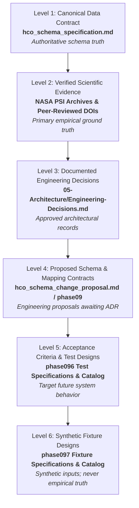
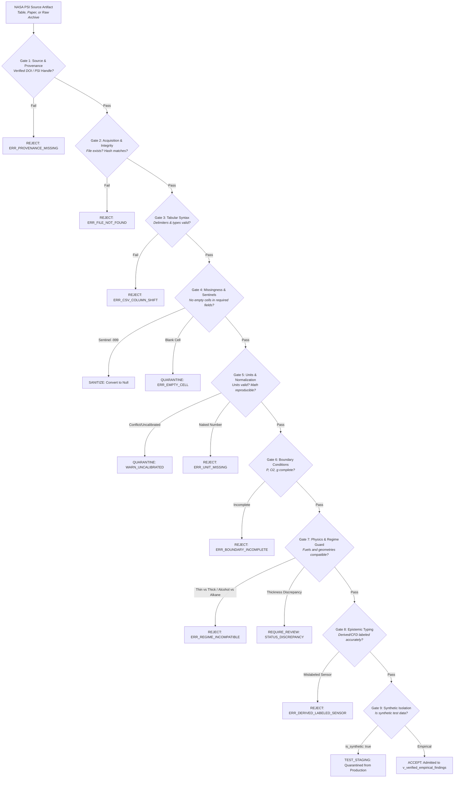
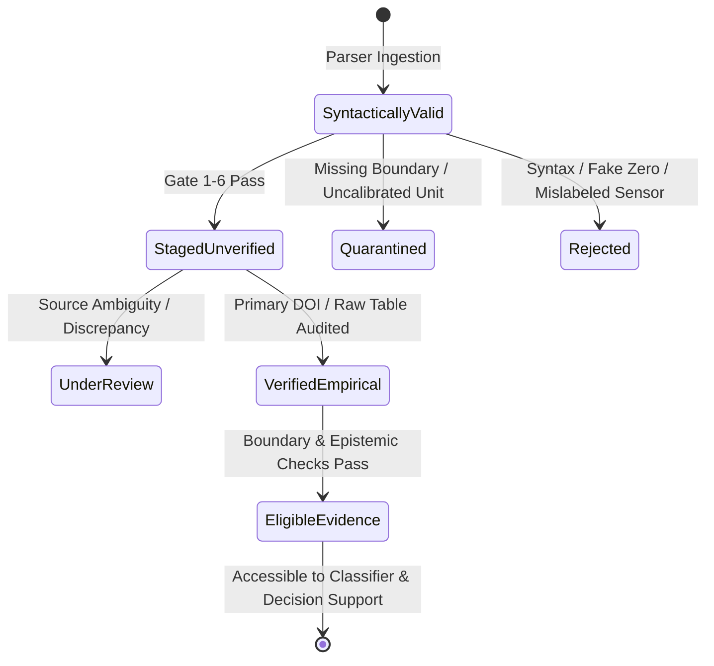

# Scientific Ingestion Contract Consolidation

**Phase**: 0.98 — Scientific Ingestion Contract Consolidation & Implementation Readiness Audit  
**Project**: FIRELINE — Fire Intelligence & Research Evidence Linkage Engine  
**Agency**: CIPHER — *Decode. Build. Evolve.*  
**Author**: Lead Full-Stack Developer & Systems Architect  
**Date**: October 11, 2026  
**Status**: Authoritative Contract Baseline (*Pre-event documentation only — consolidation of requirements; no executable code*)  
**Previous Phase**: Phase 0.97 — Scientific Fixture Design & Test Data Contract (`d3c905c`)

---

## 1. Section A: Purpose and Scope

### 1.1 Purpose
This document establishes the single authoritative implementation-readiness baseline for FIRELINE's future scientific data ingestion pipeline. It consolidates the requirements, acceptance criteria, schema contracts, and test designs established incrementally across earlier preparation phases:
* Canonical ontology: `hco_schema_specification.md`
* Schema evolution proposals: `docs/hco_schema_change_proposal.md`
* Empirical evidence audit: `docs/phase08_scientific_evidence_audit.md`
* Pre-ingestion data contracts: `docs/phase09_pre_ingestion_contract_mapping.md`
* NASA PSI artifact inventory: `docs/phase095_psi_artifact_inventory.md`
* Acceptance test specification: `docs/phase096_ingestion_test_specification.md`
* Test case catalog: `docs/phase096_test_case_catalog.md`
* Fixture design specification: `docs/phase097_fixture_design_specification.md`
* Fixture catalog: `docs/phase097_fixture_catalog.md`

### 1.2 Boundary Invariants & Pre-Event Restrictions
In strict adherence to NASA Space Apps Challenge 2026 rules and FIRELINE's engineering protocol:
1. **Consolidation Only**: This document reconciles and audits existing documents. It does not implement ingestion code, parsers, database migrations, or test harnesses.
2. **Canonical Schema Protection**: The canonical schema defined in `hco_schema_specification.md` remains 100% untouched. Proposed modifications retain the status `PROPOSED — SCHEMA DECISION REQUIRED` until formal Architectural Decision Record (ADR) approval during Phase 1.
3. **No Phantom Resolution**: Conflicting requirements, unresolved scientific discrepancies (e.g. Saffire-I thickness), and unapproved proposals are not resolved by assumption. Every conflict is documented in [`docs/phase098_contract_conflict_register.md`](phase098_contract_conflict_register.md).
4. **Competition Freeze**: Competition solution implementation remains strictly frozen until the permitted development window opens on November 14, 2026.

---

## 2. Section B: Authority Hierarchy

When documents disagree, precedence is determined by the following 6-level hierarchy rather than chronological recency. A newer completion report cannot override a canonical schema or primary scientific source.

### Precedence Invariants:
* **Canonical Supremacy**: Canonical `hco_schema_specification.md` (Level 1) overrides any schema proposal (Level 4) or fixture structure (Level 6). A field present in a synthetic fixture does not make it a canonical field.
* **Empirical Integrity**: Primary literature and uncompressed flight packages (Level 2) override portal landing page summaries or unverified research notes.
* **Proposal Isolation**: A recommendation in a phase completion report remains a proposal (Level 4) until explicitly ratified in `05-Architecture/Engineering-Decisions.md` (Level 3).
* **Test Isolation**: Acceptance tests (Level 5) and synthetic fixtures (Level 6) specify future test inputs and validation logic. They do not constitute implemented code or empirical evidence.

---

## 3. Section C: Current Contract Inventory

Independent audit of the workspace reveals the following verified baseline counts:

| Inventory Dimension | Audited Count | Authoritative Source Document | Audit Note / Variance from Historical Reports |
| :--- | :--- | :--- | :--- |
| **Canonical Entities** | **12 Entities** | `hco_schema_specification.md` | Core entities: `Investigation`, `ExperimentalRun`, `FuelSpec`, `FuelGeometry`, `EnvironmentalConditions`, `MeasurementRecord`, `EmpiricalFinding`, `EvidenceChain`, `Reference`, `AuditProvenance`, plus supporting interfaces. |
| **Ingestion Requirements** | **42 Requirements** | `docs/phase096_test_traceability_matrix.md` | Range `REQ-INGEST-01` through `REQ-INGEST-42`. Reconstructed priorities: **23 Critical, 12 High, 6 Medium, 1 Low**. |
| **Acceptance Test Cases** | **59 Tests** | `docs/phase096_test_case_catalog.md` | Verified test headers: Family A (7), Family B (7), Family C (9), Family D (6), Family E (6), Family F (6), Family G (6), Family H (6), Family I (6). *`TEST-B08` omitted from catalog header list.* |
| **Synthetic Fixtures** | **60 Fixtures** | `docs/phase097_fixture_catalog.md` | Range `FIXTURE-PROV-001` through `FIXTURE-COMP-006`. Breakdown: 15 positive progressions, 35 rejections, 6 quarantines, 4 reviews required. |
| **Open Design Decisions** | **8 Decisions** | `docs/phase097_open_fixture_design_decisions.md` | Decisions `DEC-01` through `DEC-08`. 4 defined in specification, 4 open awaiting evidence/ADR. |

---

## 4. Section D: Canonical and Proposed Representations

This table maps every scientific combustion concept across canonical HCO, proposed improvements, and test fixture representations.

| Concept | Canonical HCO Representation | Proposed Representation | Source Document | Authority Level | Conflict? | Related Decision | Implementation Implication | Status |
| :--- | :--- | :--- | :--- | :--- | :--- | :--- | :--- | :--- |
| **Investigation ID** | `investigation_id: string` | Unchanged | `hco_schema_specification.md` | Level 1 | None | None | Primary key constraint; must match NASA PSI code or DOI handle. | Established |
| **Experimental Run ID** | `run_id: string` | Composite surrogate hashing | `docs/phase097_open_fixture_design_decisions.md` | Level 4 | Minor | `DEC-06` | Generate `{INV}-{DOI_HASH}-{TAB}-{ROW}` when source lacks global run key. | Proposed |
| **Solid Fuel Material** | `material_name: string`, `chemical_formula: string` | Composite components map for blends | `docs/hco_schema_change_proposal.md` | Level 4 | Yes | `DEC-05` | Canonical single string breaks SIBAL ($75\%$ cotton / $25\%$ fiberglass); permit null formula for blends. | Blocked by Gap |
| **Specimen Geometry** | `geometry_type: string`, `dimensions: Record<string, number>` | Explicit `thickness_mm`, `radius_mm`, `biot_number` | `docs/phase09_pre_ingestion_contract_mapping.md` | Level 4 | Yes | `DEC-01` | Differentiate thin films ($Bi \ll 1$) from thick rods ($Bi \gg 1$); enforce Saffire thickness review lock. | Blocked by Decision |
| **Ambient Pressure** | `total_pressure_kpa: number` | `ScientificValue<number>` with raw unit | `docs/hco_schema_change_proposal.md` | Level 4 | Yes | None | Preserve original unit ($psia, mmHg$) alongside normalized $kPa$. | Proposed |
| **Oxygen Concentration** | `oxygen_mole_fraction: number` | Explicit basis indicator (`mole` vs `mass`) | `docs/phase096_ingestion_test_specification.md` | Level 5 | Minor | None | Quarantine ambiguous % concentrations until basis confirmed. | Defined in Test |
| **Forced Flow Velocity** | `flow_velocity_cm_s: number` (Required) | `flow_velocity_cm_s: number or null` | `docs/hco_schema_change_proposal.md` | Level 4 | **CRITICAL** | `DEC-02` | Canonical non-nullable forces `0.0` in quiescent droplet burns, corrupting physics. Adapter layer required. | Blocked by ADR |
| **Flow Direction** | `flow_direction: string` (`"opposed"` or `"concurrent"`) | Unchanged | `hco_schema_specification.md` | Level 1 | None | None | Segregate transport regimes; never merge opposed with concurrent spread. | Established |
| **Gravity Level** | `gravity_level_g: number` | Unchanged | `hco_schema_specification.md` | Level 1 | None | None | Segregate terrestrial ($1g$) from flight ($\mu g$). | Established |
| **Measurement Values** | `value: number`, `unit: string` | `ScientificValue<T>` (raw, normalized, provenance) | `docs/hco_schema_change_proposal.md` | Level 4 | Yes | None | Must store raw value, raw unit, normalized value, normalized unit, formula. | Proposed |
| **Measurement Uncertainty** | `uncertainty: number or null` | Strict honest null policy | `docs/phase096_ingestion_test_specification.md` | Level 5 | None | None | Prohibit pipeline-injected default error ($\pm 0.0$ or $\pm 5\%$). | Defined in Test |
| **Epistemic Classification** | Not modeled in canonical HCO | `epistemic_status: enum` (Measured, Derived, CFD, Hypothesis) | `docs/hco_schema_change_proposal.md` | Level 4 | Yes | None | Prevent derived calculations or CFD models from masquerading as sensor telemetry. | Proposed |
| **Source Provenance** | `AuditProvenance` entity | Enhanced with table row and coordinate URNs | `docs/phase09_pre_ingestion_contract_mapping.md` | Level 4 | None | None | Mandatory DOI, artifact URI, and table coordinate. | Proposed |
| **Synthetic Designation** | Not modeled in canonical HCO | `is_synthetic: boolean`, `synthetic_designation: string` | `docs/phase097_fixture_design_specification.md` | Level 6 | Yes | `DEC-07` | Database-level RLS filter required to prevent mock fixtures leaking into production views. | Proposed |
| **Ingestion Disposition** | Not modeled in canonical HCO | `ACCEPT`, `REJECT`, `QUARANTINE`, `REQUIRE_REVIEW` | `docs/phase096_ingestion_test_specification.md` | Level 5 | Yes | `DEC-03` | Structural syntax errors rejected; ambiguous physics quarantined in staging. | Defined in Test |

---

## 5. Section E: End-to-End Ingestion Acceptance Contract

Before incoming scientific data may enter FIRELINE's production evidence repository, it must successfully navigate 9 sequential documentary validation gates.

---

## 6. Section F: Scientific Eligibility Requirements

Passing structural JSON schema syntax checks does **not** grant a record empirical evidence status. FIRELINE defines four distinct epistemic states:

### Eligibility Invariants:
1. **Syntactic Conformance $\ne$ Empirical Truth**: A record with valid JSON data types that has not been traced to an inspected NASA table or peer-reviewed publication remains tagged `UNVERIFIED_RECORD` and cannot influence fire safety recommendations.
2. **Synthetic Data Exclusion**: Any record carrying `is_synthetic: true` is permanently tagged `NEVER_ELIGIBLE` and barred from production views.
3. **Evidence Gap Preservation**: Queries touching physical regimes outside verified empirical boundaries (e.g. Lunar partial gravity) must return an explicit `EVIDENCE_GAP` response. Black-box mathematical interpolation across unmeasured gravity regimes is strictly prohibited.

---

## 7. Section G: Validation and Exception Handling

The ingestion pipeline must enforce deterministic exception routing across six hazard classes:

| Hazard Class | Failure Condition | Pipeline Action | Exception Code | Target Disposition |
| :--- | :--- | :--- | :--- | :--- |
| **Structural Syntax** | Shifted delimiters, non-numeric strings in floats | Drop record; log file line number | `ERR_CSV_COLUMN_COUNT_MISMATCH`, `ERR_TYPE_MISMATCH` | `REJECT` |
| **Missing Values** | Unmeasured parameters | Preserve explicit `null`; ban `0.0` substitution | `INGEST_OK_HONEST_NULL_PRESERVED` | `ACCEPT` |
| **Sentinel Markers** | Legacy `-999.0`, `"N/A"`, `"--"` | Convert to `null`; log sanitizer warning | `WARN_SENTINEL_CONVERTED_TO_NULL` | `ACCEPT (Sanitized)` |
| **Unit Ambiguities** | Uncalibrated instrument displays (Fan display 62) | Store raw index; leave normalized velocity `null` | `WARN_UNCALIBRATED_INSTRUMENT_INDEX` | `QUARANTINE` |
| **Unit Conflicts** | Incompatible physical units ($14.7\text{ kPa}$ cabin) | Halt ingestion; ban automated conversion factor | `ERR_UNIT_LABEL_PHYSICAL_CONFLICT` | `REJECT` |
| **Regime Conflation** | Thin film ($Bi \ll 1$) to thick rod ($Bi \gg 1$) | Halt mapping; reject cross-geometry binding | `ERR_GEOMETRY_BIOT_REGIME_CONFLICT` | `REJECT` |
| **Source Discrepancy** | Conflicting thickness reports ($0.37\text{ cm}$ vs $0.4\text{ mm}$) | Lock record; require engineering review | `STATUS_DISCREPANCY_FLAG_THICKNESS` | `REQUIRE_REVIEW` |
| **Epistemic Fraud** | CFD or calculated estimate labeled direct sensor | Reject record; enforce derivation metadata | `ERR_DERIVED_LABELED_DIRECT_MEASUREMENT` | `REJECT` |
| **Synthetic Leakage** | Synthetic payload submitted to production API | Block with 403 Forbidden | `ERR_SYNTHETIC_DATA_IN_PRODUCTION_ENDPOINT` | `REJECT` |

---

## 8. Section H: Requirement and Test Relationships

The consolidated contract enforces bidirectional traceability across all 42 ingestion requirements:
$$\text{Requirement (REQ-INGEST-XX)} \longleftrightarrow \text{Acceptance Test (TEST-XX)} \longleftrightarrow \text{Synthetic Fixture (FIXTURE-XX)} \longleftrightarrow \text{Checklist Item (CHK-XX)}$$

* Detailed mapping for all 42 requirements is established in [`docs/phase098_traceability_audit.md`](phase098_traceability_audit.md).
* All identified conflicts and open decisions are registered in [`docs/phase098_contract_conflict_register.md`](phase098_contract_conflict_register.md).

---

## 9. Section I: Known Conflicts and Implementation Blockers

Consolidation identified **10 specific conflicts and blockers** fully documented in the conflict register:
1. `CONFLICT-098-001`: Acceptance test catalog inventory discrepancy (59 tests vs 60 test-family range; `TEST-B08` omitted from catalog).
2. `CONFLICT-098-002`: Requirement priority distribution discrepancy (Phase 0.96 report summary of 14/16/12 vs matrix ground truth of 23 Critical / 12 High / 6 Medium / 1 Low).
3. `CONFLICT-098-003`: Saffire-I specimen thickness conflict ($0.37\text{ cm}$ in PSI-98 table vs $0.4\text{ mm}$ in Urban 2019; `DEC-01`).
4. `CONFLICT-098-004`: Forced flow velocity nullability conflict (Canonical non-nullable forces `0.0` vs quiescent droplet null; `DEC-02`).
5. `CONFLICT-098-005`: BASS-II uncalibrated fan display index handling (`DEC-04`).
6. `CONFLICT-098-006`: SIBAL composite fuel single chemical formula limitation (`DEC-05`).
7. `CONFLICT-098-007`: Rejection vs quarantine database storage model specification (`DEC-03`).
8. `CONFLICT-098-008`: Surrogate run key generation strategy (`DEC-06`).
9. `CONFLICT-098-009`: Synthetic data database enforcement policy (`DEC-07`).
10. `CONFLICT-098-010`: Multimodal ingestion representation contract (CSV vs JSON; `DEC-08`).

---

## 10. Section J: Explicit Non-Goals

Phase 0.98 is strictly a contract consolidation and audit phase. The following activities remain non-goals and are prohibited:
* Writing Python ingestion scripts or pipeline workers.
* Implementing automated test harnesses or test runners.
* Creating PostgreSQL database migrations or Supabase tables.
* Downloading multi-gigabyte NASA PSI binary archives.
* Overwriting canonical `hco_schema_specification.md` to force alignment with proposed extensions.
* Arbitrarily resolving the Saffire-I thickness conflict without primary flight CAD drawing evidence.
* Executing synthetic fixtures or simulating pipeline execution.

---

## 11. Section K: Phase 1 Entry Criteria & Assessment

Transition from pre-event documentation to Phase 1 hackathon implementation is governed by 10 strict entry conditions:

| Entry Condition | Requirement Description | Current Status | Assessment & Evidence |
| :--- | :--- | :--- | :--- |
| **Cond 1: Contract Integrity** | Canonical schema distinguished from proposed extensions. | **SATISFIED** | Authority hierarchy established; canonical schema preserved. |
| **Cond 2: Core Record Representation** | Core entities clear enough to implement without inventing meaning. | **SATISFIED** | Investigation, run, fuel, environment, and measurement models defined. |
| **Cond 3: Missingness & Units** | Honest null policy and dual-unit preservation contracts established. | **SATISFIED** | Requirements `REQ-INGEST-06` to `17` fully specified with fixtures. |
| **Cond 4: Experimental Identity** | Run, fuel, and geometry conflation prevention guards defined. | **SATISFIED** | Safeguards for FLEX, BASS-II, and Saffire-I specified. |
| **Cond 5: Epistemic Integrity** | Distinction between sensor, derived, CFD, and synthetic records enforced. | **SATISFIED** | Requirements `REQ-INGEST-27` to `35` specified. |
| **Cond 6: Test Consistency** | Inventory reconciled; `TEST-B08` discrepancy resolved or documented. | **SATISFIED** | Traceability audit reconciles 59 catalog tests and logs `TEST-B08` gap. |
| **Cond 7: Bounded Source Path** | At least one bounded source ingestion path fully documented. | **SATISFIED** | Saffire-I 5-row table (`PSI98-ART-002`) fully inspected and mapped. |
| **Cond 8: Blocker Isolation** | Features blocked by open decisions isolated from initial scope. | **SATISFIED** | Quiescent droplet burning and Saffire thickness normalization isolated. |
| **Cond 9: Test Readiness** | Acceptance expectations and fixtures ready to implement. | **SATISFIED** | 60 fixtures cataloged with deterministic assertions. |
| **Cond 10: Authorized Window** | Development window open; Space Apps rules respected. | **PENDING** | Hackathon implementation window opens on November 14, 2026. |

### Final Readiness Classification:
$$\mathbf{READY\_FOR\_LIMITED\_PHASE\_1\_SCOPE}$$

**Justification**:  
The core engineering contracts, validation gates, authority hierarchy, and test fixtures are 100% defined and audit-verified. However, full ingestion cannot commence across all investigations simultaneously due to open schema decisions (`DEC-02` nullability, `DEC-01` thickness conflict). Implementation during Phase 1 must begin with a **Limited Scope**:
* **Permitted Initial Scope**: Ingestion of verified forced-flow solid combustion runs (Saffire-I sample card initial conditions from `PSI98-ART-002`, BASS-II flat PMMA film summary runs from `PSI25-ART-002`) where flow velocity is positive and boundary conditions are complete.
* **Excluded from Initial Scope**: Quiescent droplet burning (pending `DEC-02` ADR approval), Saffire-I automated thickness normalization (pending `DEC-01` primary CAD drawing inspection), and derived flow velocity calculation for uncalibrated BASS-II fan displays (pending `DEC-04` duct calibration curve staging).
