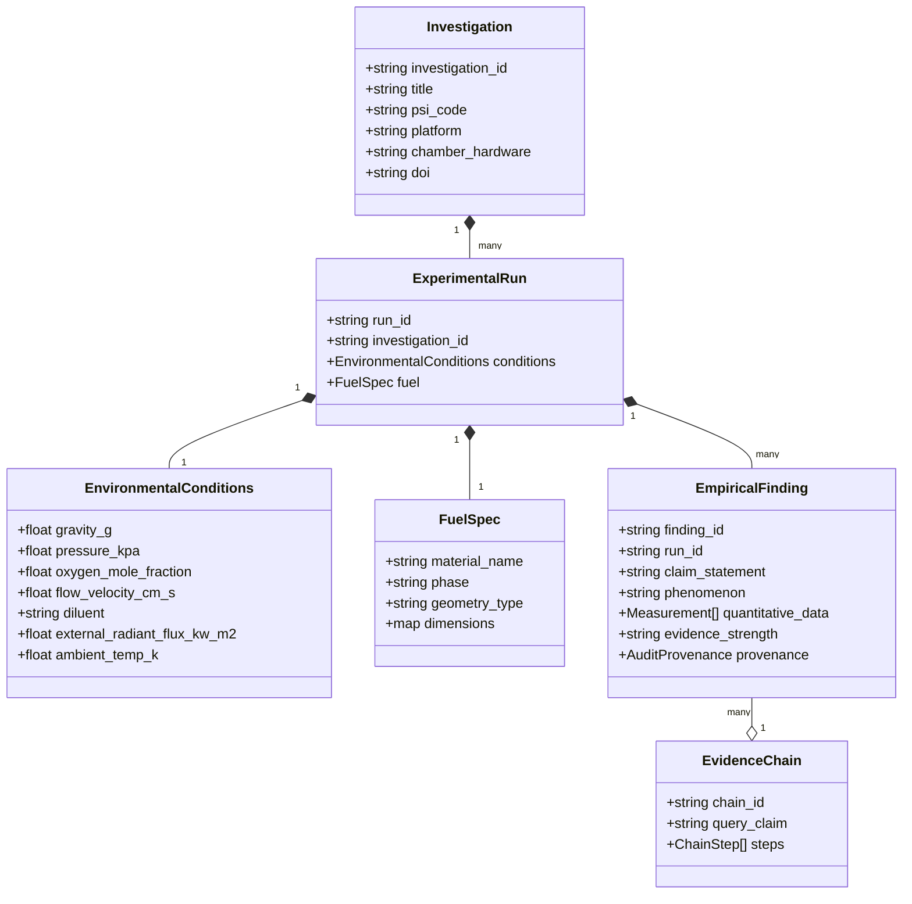

# Harmonized Combustion Ontology (HCO) — Data Specification
**Engine**: FIRELINE (Fire Intelligence & Research Evidence Linkage Engine)  
**Standard**: NASA Physical Sciences Informatics (PSI) Cross-Investigation Harmonization  
**Version**: 1.0.0-draft  
**Author**: CIPHER (*Decode. Build. Evolve.*)

---

## 1. Schema Overview

The Harmonized Combustion Ontology (HCO) converts heterogeneous microgravity combustion test data—spanning sub-millimeter droplet suspensions, duct-confined solid slabs, irradiated polymers, and full-scale spacecraft vehicle fabrics—into a normalized parametric evidence structure.



---

## 2. TypeScript Data Model

```typescript
export type GravityRegime = 'microgravity' | 'lunar' | 'martian' | 'terrestrial';
export type FuelPhase = 'solid' | 'liquid' | 'gaseous';
export type FuelGeometry = 
  | 'suspended_droplet' 
  | 'flat_slab' 
  | 'cylindrical_rod' 
  | 'fabric_sheet' 
  | 'porous_matrix'
  | 'co_flow_burner';

export type CombustionPhenomenon = 
  | 'flame_extinction_quenching'
  | 'flame_spread_rate'
  | 'ignition_delay'
  | 'burning_rate'
  | 'cool_flame_transition'
  | 'soot_and_smoke_production'
  | 'flammability_limit';

export type EvidenceClassification = 'SUPPORTED' | 'INFERRED' | 'EVIDENCE_GAP';

export interface EnvironmentalConditions {
  /** Gravity expressed in g0 units (e.g., 0.0 for ISS, 0.16 for Moon, 0.38 for Mars, 1.0 for 1g) */
  gravity_g: number;
  /** Ambient chamber pressure in kPa (40.0 - 101.3 kPa standard range) */
  pressure_kpa: number;
  /** Oxygen concentration mole fraction (e.g., 0.21 for 21% O2, 0.34 for 34% O2) */
  oxygen_mole_fraction: number;
  /** Forced convective ventilation speed across fuel surface in cm/s */
  flow_velocity_cm_s: number;
  /** Ambient diluent gas species */
  diluent: 'N2' | 'CO2' | 'He' | 'Ar' | 'mixed';
  /** Optional external radiant heat flux applied to fuel surface in kW/m^2 */
  external_radiant_flux_kw_m2?: number;
  /** Background ambient temperature in Kelvin */
  ambient_temp_k: number;
}

export interface FuelDimensions {
  thickness_mm?: number;
  diameter_mm?: number;
  width_mm?: number;
  length_mm?: number;
  aspect_ratio?: number;
}

export interface FuelSpec {
  material_name: string;
  chemical_formula?: string;
  phase: FuelPhase;
  geometry_type: FuelGeometry;
  dimensions: FuelDimensions;
  thermally_thin: boolean;
}

export interface MeasurementRecord {
  metric_name: string;
  metric_symbol: string;
  value: number;
  unit: string;
  uncertainty?: number;
  measurement_method: 'thermocouple' | 'radiometer' | 'optical_tracking' | 'pyrometer' | 'pressure_transducer';
}

export interface AuditProvenance {
  psi_investigation_code: string; // e.g. "PSI-98"
  psi_run_id: string;             // e.g. "SAFFIRE-I_RUN_04"
  raw_telemetry_file?: string;    // e.g. "data_table_tc_run04.csv"
  video_frame_timestamp_s?: number;
  peer_reviewed_doi?: string;     // e.g. "10.1016/j.combustflame.2018.04.019"
  psi_direct_url: string;
}

export interface EmpiricalFinding {
  finding_id: string;
  investigation_id: string;
  run_id: string;
  claim_statement: string;
  phenomenon: CombustionPhenomenon;
  qualitative_trend: 'increases' | 'decreases' | 'suppressed' | 'invariant' | 'quenched';
  environmental_conditions: EnvironmentalConditions;
  fuel: FuelSpec;
  quantitative_measurements: MeasurementRecord[];
  evidence_strength: 'definitive' | 'moderate' | 'screening_only';
  provenance: AuditProvenance;
}

export interface EvidenceChainStep {
  step_order: number;
  stage: 'query' | 'claim' | 'investigation' | 'condition' | 'measurement' | 'observation' | 'provenance';
  label: string;
  description: string;
  node_id: string;
  verified: boolean;
}

export interface EvidenceChain {
  chain_id: string;
  query_id: string;
  target_question: string;
  claim_summary: string;
  steps: EvidenceChainStep[];
}

export interface AxisDeficit {
  parameter_name: keyof EnvironmentalConditions;
  tested_range: [number, number];
  query_value: number;
  normalized_distance: number;
  axis_coverage_score: number; // 0.0 to 1.0
}

export interface NextExperimentRecommendation {
  target_investigation_type: string;
  priority_score: number; // 0.0 to 1.0
  recommended_fuel: FuelSpec;
  target_conditions: EnvironmentalConditions;
  primary_observables: CombustionPhenomenon[];
  recommended_instrumentation: string[];
  justification: string;
}

export interface EvidenceAssessmentResult {
  query_id: string;
  mission_context: string;
  input_conditions: EnvironmentalConditions;
  fuel_spec: FuelSpec;
  overall_coverage_index: number; // 0.0 (total void) to 1.0 (dense empirical support)
  classification: EvidenceClassification;
  supported_findings: EmpiricalFinding[];
  inferred_behaviors: {
    mechanism: string;
    scaling_law: string;
    extrapolation_confidence: 'high' | 'moderate' | 'low';
    governing_dimensionless_number: string;
  }[];
  axis_deficits: AxisDeficit[];
  next_experiment?: NextExperimentRecommendation;
}
```

---

## 3. Concrete Ground-Truth Records (PSI Investigations)

### Record 1: FLEX (PSI-69) — Liquid Droplet Extinction
```json
{
  "finding_id": "FINDING-FLEX-082",
  "investigation_id": "PSI-69-FLEX",
  "run_id": "FLEX_ISS_CIR_HEP_042",
  "claim_statement": "Under microgravity conditions, n-heptane droplets exhibit radiative extinction at larger diameters than in terrestrial buoyant conditions due to lack of convective heat loss.",
  "phenomenon": "flame_extinction_quenching",
  "qualitative_trend": "quenched",
  "environmental_conditions": {
    "gravity_g": 0.0,
    "pressure_kpa": 101.3,
    "oxygen_mole_fraction": 0.21,
    "flow_velocity_cm_s": 0.0,
    "diluent": "N2",
    "ambient_temp_k": 298.15
  },
  "fuel": {
    "material_name": "n-Heptane",
    "chemical_formula": "C7H16",
    "phase": "liquid",
    "geometry_type": "suspended_droplet",
    "dimensions": {
      "diameter_mm": 2.14
    },
    "thermally_thin": false
  },
  "quantitative_measurements": [
    {
      "metric_name": "Extinction Diameter",
      "metric_symbol": "d_ext",
      "value": 1.42,
      "unit": "mm",
      "uncertainty": 0.04,
      "measurement_method": "optical_tracking"
    },
    {
      "metric_name": "Burning Rate Constant",
      "metric_symbol": "K",
      "value": 0.58,
      "unit": "mm^2/s",
      "uncertainty": 0.02,
      "measurement_method": "optical_tracking"
    }
  ],
  "evidence_strength": "definitive",
  "provenance": {
    "psi_investigation_code": "PSI-69",
    "psi_run_id": "FLEX_HEP_042",
    "raw_telemetry_file": "droplet_diameter_series_42.csv",
    "video_frame_timestamp_s": 14.82,
    "peer_reviewed_doi": "10.1016/j.combustflame.2012.06.012",
    "psi_direct_url": "https://psi.nasa.gov/physci/repo/data/investigations/PSI-69"
  }
}
```

### Record 2: BASS-II (PSI-25) — Solid Fuel Opposed Flame Spread
```json
{
  "finding_id": "FINDING-BASS2-114",
  "investigation_id": "PSI-25-BASS-II",
  "run_id": "BASS2_PMMA_FLAT_RUN18",
  "claim_statement": "In opposed microgravity flow, flame spread rate over flat PMMA sheets scales non-monotonically with airflow velocity, reaching an extinction boundary below 1.5 cm/s due to radiative cooling.",
  "phenomenon": "flame_spread_rate",
  "qualitative_trend": "decreases",
  "environmental_conditions": {
    "gravity_g": 0.0,
    "pressure_kpa": 101.3,
    "oxygen_mole_fraction": 0.208,
    "flow_velocity_cm_s": 2.2,
    "diluent": "N2",
    "ambient_temp_k": 296.0
  },
  "fuel": {
    "material_name": "Polymethyl Methacrylate (PMMA)",
    "chemical_formula": "(C5O2H8)n",
    "phase": "solid",
    "geometry_type": "flat_slab",
    "dimensions": {
      "thickness_mm": 1.2,
      "width_mm": 10.0,
      "length_mm": 100.0
    },
    "thermally_thin": true
  },
  "quantitative_measurements": [
    {
      "metric_name": "Flame Spread Rate",
      "metric_symbol": "V_f",
      "value": 0.068,
      "unit": "mm/s",
      "uncertainty": 0.005,
      "measurement_method": "optical_tracking"
    },
    {
      "metric_name": "Peak Flame Temperature",
      "metric_symbol": "T_flame",
      "value": 1420.0,
      "unit": "K",
      "uncertainty": 25.0,
      "measurement_method": "thermocouple"
    }
  ],
  "evidence_strength": "definitive",
  "provenance": {
    "psi_investigation_code": "PSI-25",
    "psi_run_id": "BASS-II_FLAT_18",
    "raw_telemetry_file": "bass2_thermocouple_tc1_tc4_run18.csv",
    "video_frame_timestamp_s": 42.1,
    "peer_reviewed_doi": "10.1016/j.proci.2014.05.021",
    "psi_direct_url": "https://psi.nasa.gov/physci/repo/data/investigations/PSI-25"
  }
}
```

### Record 3: Saffire-I (PSI-98) — Large-Scale Spacecraft Fabric Burn
```json
{
  "finding_id": "FINDING-SAFFIRE1-004",
  "investigation_id": "PSI-98-SAFFIRE",
  "run_id": "SAFFIRE_I_BURN_01",
  "claim_statement": "Large-scale SIBAL fabric ignited in Cygnus pressurized cargo cabin at 0g demonstrates sustained concurrent flame spread at 20 cm/s flow, producing a wide parabolic flame base without buoyant necking.",
  "phenomenon": "flame_spread_rate",
  "qualitative_trend": "increases",
  "environmental_conditions": {
    "gravity_g": 0.0,
    "pressure_kpa": 70.3,
    "oxygen_mole_fraction": 0.21,
    "flow_velocity_cm_s": 20.0,
    "diluent": "N2",
    "ambient_temp_k": 294.5
  },
  "fuel": {
    "material_name": "SIBAL (Cotton/Fiberglass Blend)",
    "phase": "solid",
    "geometry_type": "fabric_sheet",
    "dimensions": {
      "thickness_mm": 0.4,
      "width_mm": 400.0,
      "length_mm": 940.0
    },
    "thermally_thin": true
  },
  "quantitative_measurements": [
    {
      "metric_name": "Concurrent Spread Rate",
      "metric_symbol": "V_f_conc",
      "value": 2.4,
      "unit": "mm/s",
      "uncertainty": 0.15,
      "measurement_method": "optical_tracking"
    },
    {
      "metric_name": "Maximum Chamber Pressure Rise",
      "metric_symbol": "Delta_P",
      "value": 3.8,
      "unit": "kPa",
      "uncertainty": 0.2,
      "measurement_method": "pressure_transducer"
    }
  ],
  "evidence_strength": "definitive",
  "provenance": {
    "psi_investigation_code": "PSI-98",
    "psi_run_id": "SAFFIRE-I-01",
    "raw_telemetry_file": "saffire_i_environmental_telemetry.csv",
    "video_frame_timestamp_s": 128.5,
    "peer_reviewed_doi": "10.1016/j.combustflame.2018.04.019",
    "psi_direct_url": "https://psi.nasa.gov/physci/repo/data/investigations/PSI-98"
  }
}
```

### Record 4: SoFIE-MIST (PSI-104) — Irradiated Polymer Extinction Limit
```json
{
  "finding_id": "FINDING-SOFIE-MIST-031",
  "investigation_id": "PSI-104-SOFIE",
  "run_id": "SOFIE_MIST_RAD_PMMA_12",
  "claim_statement": "External radiant flux significantly extends the microgravity low-flow extinction limit of solid PMMA, permitting sustained burning at airflow velocities as low as 0.2 cm/s.",
  "phenomenon": "flame_extinction_quenching",
  "qualitative_trend": "suppressed",
  "environmental_conditions": {
    "gravity_g": 0.0,
    "pressure_kpa": 101.3,
    "oxygen_mole_fraction": 0.19,
    "flow_velocity_cm_s": 0.5,
    "diluent": "N2",
    "external_radiant_flux_kw_m2": 15.0,
    "ambient_temp_k": 298.0
  },
  "fuel": {
    "material_name": "Clear Cast PMMA Cylinder",
    "phase": "solid",
    "geometry_type": "cylindrical_rod",
    "dimensions": {
      "diameter_mm": 6.35,
      "length_mm": 50.0
    },
    "thermally_thin": false
  },
  "quantitative_measurements": [
    {
      "metric_name": "Critical Extinction Flux",
      "metric_symbol": "q_ext",
      "value": 8.2,
      "unit": "kW/m^2",
      "uncertainty": 0.6,
      "measurement_method": "radiometer"
    }
  ],
  "evidence_strength": "definitive",
  "provenance": {
    "psi_investigation_code": "PSI-104",
    "psi_run_id": "SOFIE_MIST_12",
    "raw_telemetry_file": "sofie_mist_radiometer_log_12.csv",
    "video_frame_timestamp_s": 95.0,
    "peer_reviewed_doi": "10.1016/j.proci.2022.07.018",
    "psi_direct_url": "https://psi.nasa.gov/physci/repo/data/investigations/PSI-104"
  }
}
```

---

## 4. Evidence Classification & Gap Logic

```python
# Pseudocode implementation of FIRELINE Tri-Classification & Evidence Gap

import numpy as np
from scipy.spatial import Delaunay

# Normalized 4D environmental parameter space: [g, P_norm, X_O2_norm, u_norm]
BOUNDS = {
    'gravity_g': (0.0, 1.0),
    'pressure_kpa': (40.0, 101.3),
    'oxygen_mole_fraction': (0.15, 0.40),
    'flow_velocity_cm_s': (0.0, 30.0)
}

def normalize_point(cond: dict) -> np.ndarray:
    return np.array([
        (cond['gravity_g'] - BOUNDS['gravity_g'][0]) / (BOUNDS['gravity_g'][1] - BOUNDS['gravity_g'][0]),
        (cond['pressure_kpa'] - BOUNDS['pressure_kpa'][0]) / (BOUNDS['pressure_kpa'][1] - BOUNDS['pressure_kpa'][0]),
        (cond['oxygen_mole_fraction'] - BOUNDS['oxygen_mole_fraction'][0]) / (BOUNDS['oxygen_mole_fraction'][1] - BOUNDS['oxygen_mole_fraction'][0]),
        (cond['flow_velocity_cm_s'] - BOUNDS['flow_velocity_cm_s'][0]) / (BOUNDS['flow_velocity_cm_s'][1] - BOUNDS['flow_velocity_cm_s'][0]),
    ])

def classify_evidence(query_point_norm: np.ndarray, existing_points_norm: np.ndarray, hull: Delaunay, radius_epsilon=0.15):
    # 1. Check Convex Hull interior
    is_inside_hull = (hull.find_simplex(query_point_norm) >= 0)
    
    # 2. Compute local sample density within radius epsilon
    distances = np.linalg.norm(existing_points_norm - query_point_norm, axis=1)
    local_neighbors = np.sum(distances <= radius_epsilon)
    coverage_score = float(1.0 - np.exp(-0.8 * local_neighbors)) # Saturates as samples increase
    
    # 3. Tri-classification decision
    if is_inside_hull and coverage_score >= 0.70:
        classification = "SUPPORTED"
    elif is_inside_hull or (coverage_score >= 0.35):
        classification = "INFERRED"
    else:
        classification = "EVIDENCE_GAP"
        
    return {
        "classification": classification,
        "coverage_index": round(coverage_score, 3),
        "min_distance_to_empirical_run": round(float(np.min(distances)), 3)
    }
```
